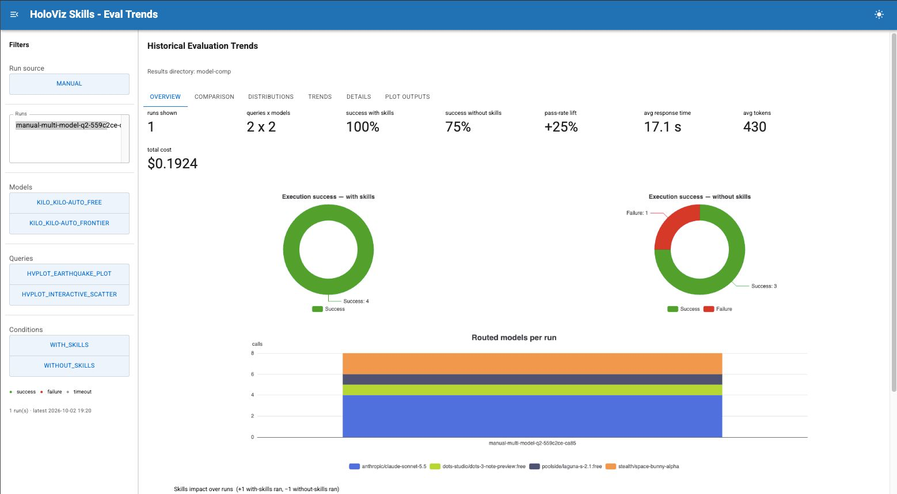
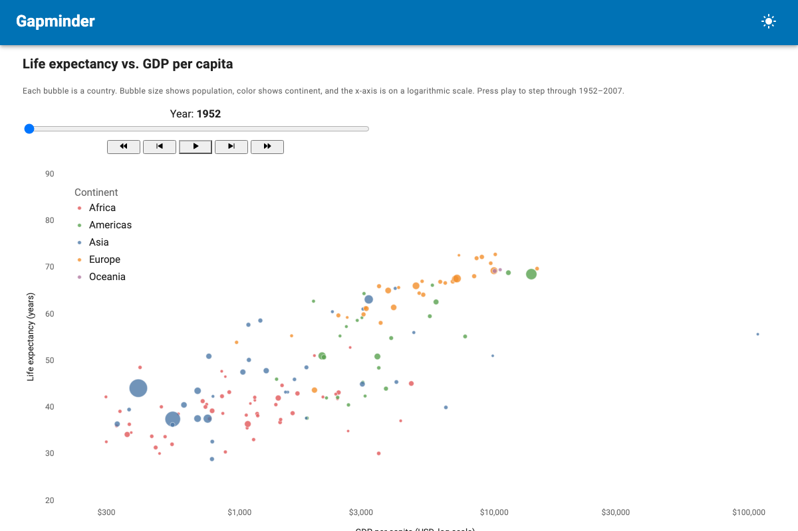
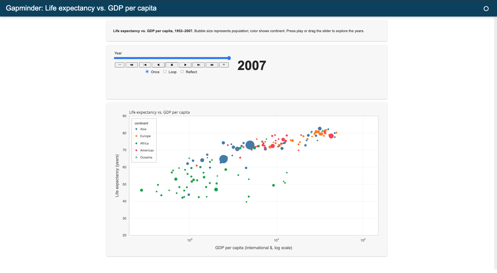

## Introduction

In our [first post](../holoviz_llm/index.md), we explored how agent skills could help AI coding assistants produce more accurate, maintainable, and idiomatic HoloViz code. We wanted to give models focused guidance on common mistakes and the approaches maintainers recommend.

Since then, our work on [holoviz-skills](https://github.com/holoviz-dev/holoviz-skills) has focused on making that guidance reliable and measuring whether it helps.

## Expanding the Skills

The skills now cover more HoloViz workflows, including building Panel applications, working with geographic data, and handling large datasets. They are organized so an assistant can find relevant guidance without loading everything at once.

We have also expanded the contribution guidance for HoloViz projects. The skills cover coding and testing conventions as well as pull request descriptions, reproducible examples, and code and prose review. They capture advice that maintainers often share during reviews.

The HoloViz Skills [documentation](https://skills.holoviz.org/#using-skills) includes installation and usage instructions.

## Making the Guidance More Reliable

While preparing the 0.1.0 release, we ran the code examples and checked the recommendations against current library behavior. We found mistakes in our own guidance, including recommendations that caused errors or behaved differently from what we described.

A skill can sound authoritative and still give incorrect advice, steering an assistant toward the mistakes we are trying to prevent.

We test and maintain the examples and recommendations over time. We have also made it easier for assistants to find relevant library documentation and connect error messages to troubleshooting guidance.

## Moving Beyond Written Advice

Clear instructions are valuable, but some problems are better caught by a check than by another paragraph of advice.

For Panel applications, we added tools that assistants can run to catch coding mistakes and layout problems. The checks flag content that overflows the page, controls that are too small, and text that is difficult to read. Assistants can use this feedback to improve an application before presenting it to the user.

Visual review still matters: a layout can pass automated checks and remain confusing or poorly organized. Automated checks can catch measurable problems, while screenshots and visual inspection help assess questions that require judgment.

We are applying the same approach to maintenance work, using automated checks to flag recurring code and prose patterns. The skills give assistants ways to check their work as well as instructions to follow.

## Improving the Evaluation Framework

In the first post, we described a framework for comparing responses with and without skills. Since then, we have focused on making those comparisons easier to inspect and more informative.

The framework now uses the Kilo Code CLI to compare model tiers. It records which models were used, whether the assistant consulted the skills, and each run's time, token usage, and cost. A dashboard brings the results together so we can track them over time.

We have also strengthened safeguards for running AI-generated code. Evaluation runs are separate from the credentials used to publish results, which lets us automate evaluations while keeping those credentials out of the execution environment.

We are extending evaluation beyond plotting tasks into code cleanup to see whether skills can help with contributor work as well as application development. Repeated runs help us assess how consistently an assistant performs, not just whether it succeeds once.

## What the evals showed

The final eval queries show that skills can change the result even when an assistant without them still produces working output. The difference is not always whether code runs and an output is generated; it can also be how closely the app follows the HoloViz gguidelines and how useful the finished result is. This matters because a successful run alone does not capture the full effect of the guidance.

The Gapminder comparison offers one visual example. Both runs produce a chart of life expectancy against GDP per capita, but the apps differ in layout: one produces a result as expected while the other, not only produces a working result but closely mirrors the HoloViz recommendations.

**With skills**

**Without skills**

## Lessons Learned

The central idea from the first post still holds: useful skills grow from observing where models struggle. We have changed how we turn those observations into guidance we can trust.

Checking our examples matters as much as checking the model's output. When we can detect a mistake automatically, giving the assistant a way to test for it is more useful than relying on instructions alone. Measuring a skill also means looking at consistency and cost alongside whether the generated code works.

The lessons from this work have shaped an ongoing feedback loop between the skills, the tools that check them, and the evaluations that guide our next changes.

## What's left

Coverage remains limited. We currently have only four (4) eval queries that cover hvPlot, HoloViews and Panel skills, plus additional skills for `cleanup`. Panel, HoloViews, and Param have much more content than tests. The routed model changes between runs, making comparisons noisy. Skill versions use CalVer dates to record when a skill last changed, but not which library versions it was checked against. We need to rerun checks as the libraries change.

If you try the skills, tell us where they help and where they get in the way on the [repository](https://github.com/holoviz-dev/holoviz-skills), our [Discord channel](https://discord.com/channels/1075331058024861767/1461037371591233767), or [Discourse](https://discourse.holoviz.org/).

## Acknowledgements

Thank you to [@ghostiee-11](https://github.com/ghostiee-11), [@hoxbro](https://github.com/hoxbro), and everyone who has contributed to HoloViz Skills. Their contributions and feedback have helped shape the project as it continues to evolve.
