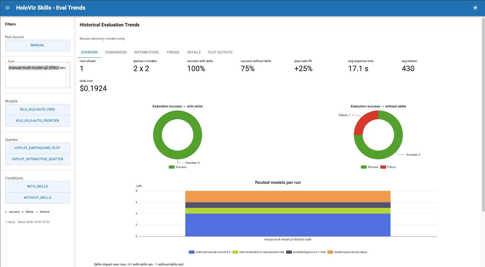

## Introduction

In our [first post](../holoviz_llm/index.md), we explored how agent skills could help AI coding assistants produce more accurate, maintainable, and idiomatic HoloViz code. The idea was to give models focused guidance on the mistakes they commonly make and the approaches that maintainers recommend.

Since then, our work on [holoviz-skills](https://github.com/holoviz-dev/holoviz-skills) has focused on a related question:

“How do we make that guidance reliable, and how do we know whether it helps?”

This follow-up looks at how the skills have evolved, what we have learned from checking our own recommendations, and the improvements we have made to the evaluation framework.

## Expanding the Skills

The repository now covers a broader range of HoloViz workflows, from building Panel applications to working with geographic data and large datasets. The skills are organized so that an assistant can find the guidance relevant to its task without having to load everything at once.

We have also expanded the guidance for contributing to HoloViz projects. Alongside coding and testing conventions, the skills now help with writing pull request descriptions, creating reproducible examples, and reviewing code and prose. The aim is to capture the everyday advice that maintainers would otherwise need to repeat during reviews.

The HoloViz Skills [documentation](https://skills.holoviz.org/#using-skills) includes installation and usage instructions.

## Making the Guidance More Reliable

One of the most useful exercises was checking the skills themselves. While preparing the 0.1.0 release, we ran the code examples and checked the recommendations against current library behavior. This uncovered mistakes in our own guidance, including advice that looked reasonable but produced errors or behaved differently from what we described.

That experience reinforced an important lesson: a skill is not useful simply because it sounds authoritative. Incorrect guidance can steer an assistant toward the very mistakes we are trying to prevent.

We now treat the examples and recommendations as something to test and maintain, rather than as documentation we can write once and leave alone. We have also made it easier for assistants to find the relevant library documentation and connect error messages to troubleshooting guidance.

## Moving Beyond Written Advice

Clear instructions are valuable, but some problems are better caught by a check than by another paragraph of advice.

For Panel applications, we added tools that assistants can run to identify common coding mistakes and layout problems. These checks cover issues such as content overflowing the page, controls that are too small, and text that is difficult to read. They give the assistant concrete feedback it can act on before presenting an application to the user.

Visual review still matters. A layout can pass automated checks and still be confusing or poorly organized. The goal is to use those checks for problems we can measure, leaving screenshots and visual inspection for questions that require judgment.

The same approach extends to maintenance work, where automated checks help flag recurring code and prose patterns for review. Across both areas, the skills are becoming more than a collection of instructions: they also give assistants ways to check their work.

## Improving the Evaluation Framework

In the first post, we described a framework for comparing responses with and without skills. Since then, we have focused on making those comparisons easier to inspect and more informative.

The framework now uses the Kilo Code CLI to support comparisons across model tiers. It records which models were used, whether the assistant consulted the skills, and how much time, token usage, and cost each run involved. A dashboard brings these measurements together so we can follow results over time rather than rely on isolated examples.

We have also strengthened the safeguards around running AI-generated code, keeping evaluation separate from the credentials used to publish results. This is an important part of making the framework suitable for automated runs.

Evaluation is beginning to extend beyond plotting tasks into code cleanup. These checks help us explore whether skills can support contributor workflows as well as application development. They also remind us that a single successful run is not enough: repeated evaluations are needed to understand how consistently an assistant performs.

## What the evals showed

<!-- TODO: Skip for now. Fill up when we add and run the final queries -->

## Lessons Learned

The central idea from the first post still holds: useful skills grow from observing where models struggle. What has changed is how we turn those observations into guidance we can trust.

Checking our own examples has become just as important as checking the model's output. Where a mistake can be detected automatically, giving the assistant a way to test for it is more useful than relying on instructions alone. And when measuring the effect of a skill, we need to consider consistency and cost alongside whether the generated code works.

These lessons have shaped the project into an ongoing feedback loop between the skills, the tools that check them, and the evaluations that help us decide what to improve next.

## What's left

Coverage is the main gap. Nearly all evals are hvPlot, plus the one for `cleanup`, while the Panel, HoloViews and Param skills have far more content than tests. The routed model changes between runs, which makes comparisons across runs noisy. And skill versions are now CalVer dates that record when a skill last changed, but not which library versions it was checked against. Someone has to rerun the checks as the libraries move.

<!-- TODO: Improve this section when we add more eval queries for other libraries -->

If you try the skills, tell us where they help and where they get in the way, on the [repository](https://github.com/holoviz-dev/holoviz-skills), our [Discord channel](https://discord.com/channels/1075331058024861767/1461037371591233767) or [Discourse](https://discourse.holoviz.org/).

## Acknowledgements

Thank you to [@ghostiee-11](https://github.com/ghostiee-11), [@hoxbro](https://github.com/hoxbro), and everyone who has contributed to HoloViz Skills. Their contributions and feedback have helped shape the project as it continues to evolve.
