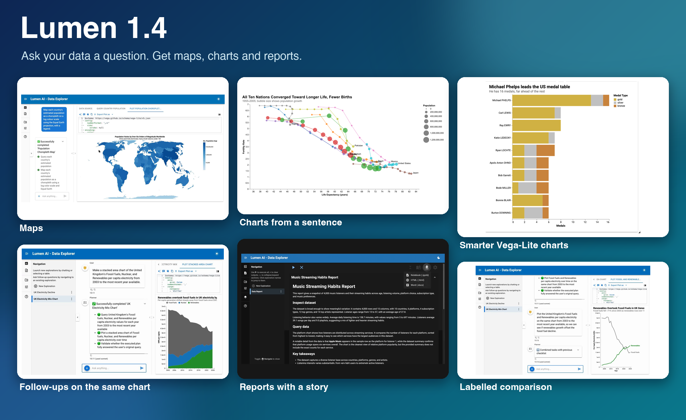
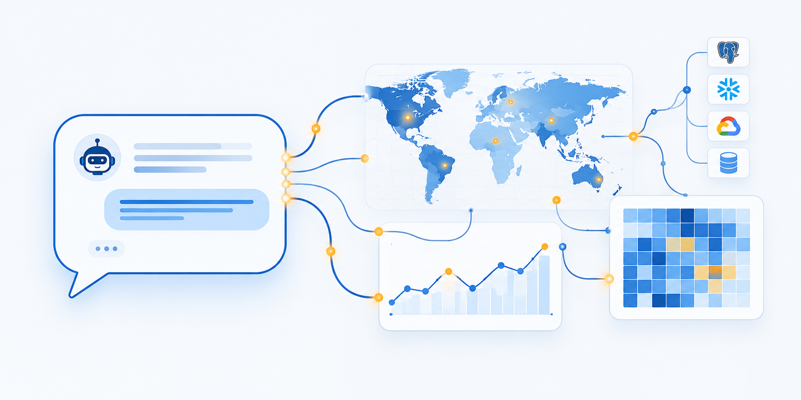
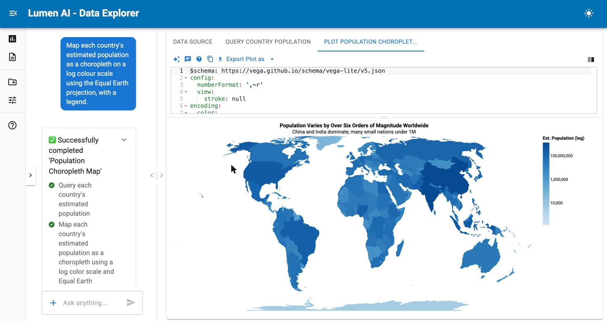
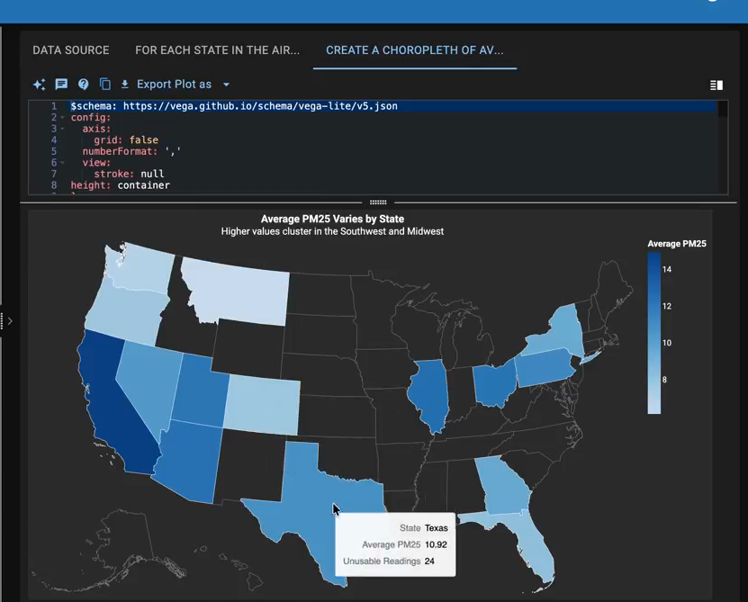
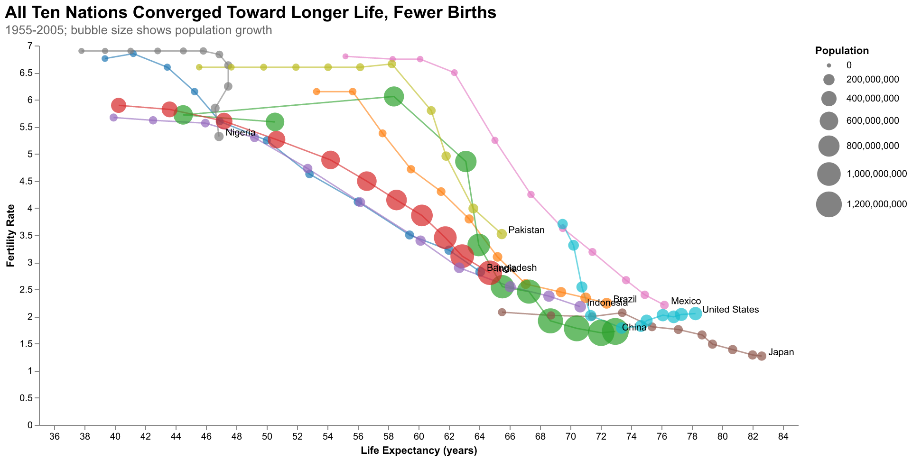
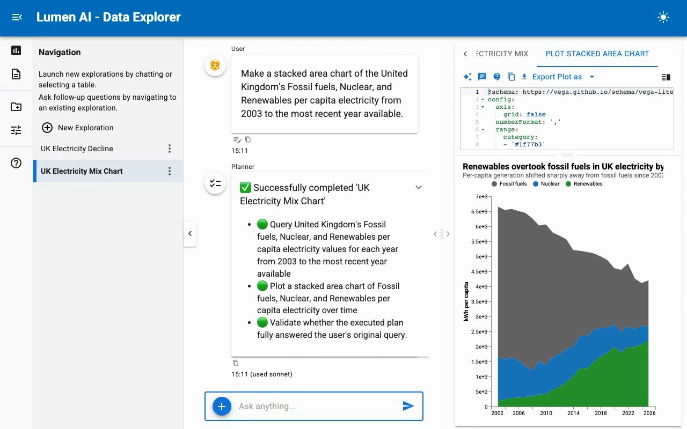
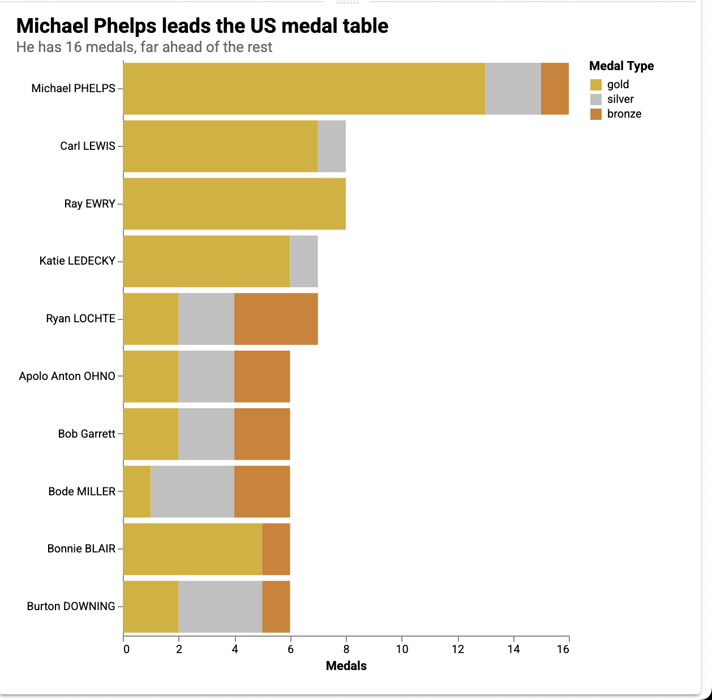
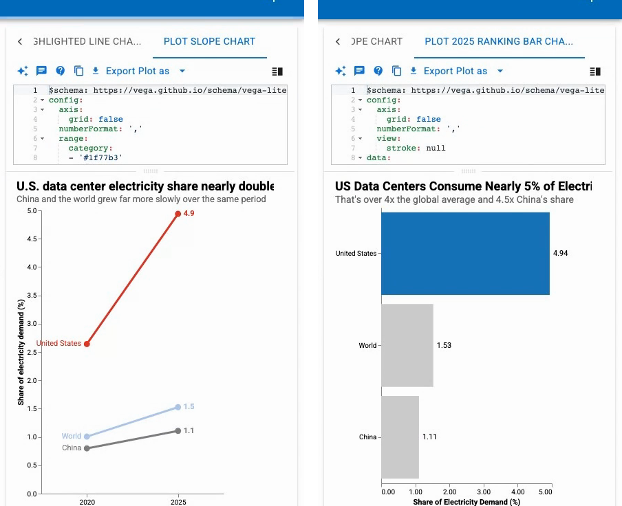
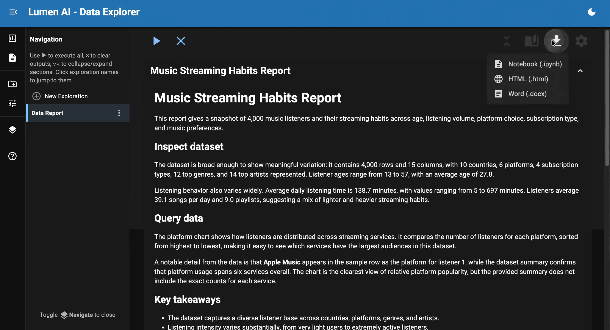

</img>

## What is Lumen?

[Lumen](https://lumen.holoviz.org/) is an open-source framework for **conversational data exploration and analysis**. You ask a question about your data, and an LLM proposes the SQL, the transformations and the chart. Every step stays visible, editable and re-runnable. Lumen is built on [Panel](https://panel.holoviz.org/) and the rest of the [HoloViz](https://holoviz.org) ecosystem, so the results are interactive tables, plots and dashboards. If you are new to it, the [Lumen 1.0 announcement](../lumen_1.0/index.md) explains the design.

{fig-alt="A chat bubble with a robot avatar, joined by glowing lines to a world map, a line and bar chart, a grid heatmap and four data-source icons: a database, a cloud, a table and a file."}

## New Release!

We are excited to announce the 1.4.0 release of Lumen! This release makes Lumen easier to start and cheaper to run well. You no longer need an API key to try it, answers rest on better table context, and a report can write its own story. Here's a high-level overview of the highlights:

- [**Run it without an API key**](#run-lumen-without-an-api-key): `lumen-ai serve` works with the Claude Code, Codex and GitHub Copilot CLIs you are already signed in to, with Kilo's free models, or with a local Ollama. With nothing set up, it tells you which of these to try.
- [**Maps from geometry columns**](#maps-and-geospatial-data): a table's own geometry column now draws as a choropleth, and GeoJSON files load end to end.
- [**Reports with a story**](#reports-with-a-story): an Annotate button writes a summary and a note under each section, and a report exports to Word.
- [**Answers you can check**](#answers-you-can-check): agents get a compact, exact profile of each table, tool errors go back to the model instead of ending the attempt, and every SQL result is checked for data-quality problems.
- [**Usage and cost tracking**](#usage-and-cost-tracking): see tokens and dollars per call, and trace every model and tool call.
- [**Polars and PyArrow**](#polars-and-pyarrow): sources can return polars or pyarrow frames, and filters and most transforms run on them natively.

Lumen 1.4 requires Python 3.11 or later, Panel 1.9 or later and Bokeh 3.9 or later.

Many thanks to the contributors to this release: [@ghostiee-11](https://github.com/ghostiee-11), [@philippjfr](https://github.com/philippjfr), [@ahuang11](https://github.com/ahuang11), [@vignesh-chaturvedi](https://github.com/vignesh-chaturvedi), [@SajalDevX](https://github.com/SajalDevX), [@DevForge255](https://github.com/DevForge255), [@7487](https://github.com/7487), [@rimsha152007-dotcom](https://github.com/rimsha152007-dotcom), [@fly1d](https://github.com/fly1d), [@Vamshi1404](https://github.com/Vamshi1404), [@hoxbro](https://github.com/hoxbro), [@AmirF194](https://github.com/AmirF194), [@yiboban](https://github.com/yiboban), [@raashish1601](https://github.com/raashish1601), [@nightcityblade](https://github.com/nightcityblade), [@mayuriphad](https://github.com/mayuriphad), [@mahdibani](https://github.com/mahdibani), [@latent-9](https://github.com/latent-9), [@Zayn329](https://github.com/Zayn329), [@SuMayaBee](https://github.com/SuMayaBee), [@Mr-Neutr0n](https://github.com/Mr-Neutr0n), [@Coderambling](https://github.com/Coderambling), [@umi008](https://github.com/umi008), [@jadhavgaurav](https://github.com/jadhavgaurav).

A special welcome to our new contributors: [@vignesh-chaturvedi](https://github.com/vignesh-chaturvedi), [@SajalDevX](https://github.com/SajalDevX), [@DevForge255](https://github.com/DevForge255), [@7487](https://github.com/7487), [@rimsha152007-dotcom](https://github.com/rimsha152007-dotcom), [@fly1d](https://github.com/fly1d), [@Vamshi1404](https://github.com/Vamshi1404), [@AmirF194](https://github.com/AmirF194), [@yiboban](https://github.com/yiboban), [@raashish1601](https://github.com/raashish1601), [@nightcityblade](https://github.com/nightcityblade), [@mayuriphad](https://github.com/mayuriphad), [@mahdibani](https://github.com/mahdibani), [@latent-9](https://github.com/latent-9), [@Zayn329](https://github.com/Zayn329), [@Mr-Neutr0n](https://github.com/Mr-Neutr0n), [@umi008](https://github.com/umi008), [@jadhavgaurav](https://github.com/jadhavgaurav).

## Run Lumen Without an API Key

Without an API key, `lumen-ai serve` used to start against a provider that was not there. In 1.4 there are four ways to get going without one.

### Coding CLIs

If you are signed in to Claude Code, Codex or the GitHub Copilot CLI, Lumen can use it as its LLM:

```bash
lumen-ai serve penguins.csv --provider claude-code
```

The other values are `codex-cli` and `copilot-cli`, and `antigravity-cli` is available too. The Claude Code and Copilot providers run the CLI with its own tools switched off and in an empty temporary directory, so it answers Lumen's prompts without reading the folder you launched from.

One limit: Lumen's own tools are not forwarded to these CLIs. An action that needs the model to call a tool, such as fetching a URL from the chat, cannot run, so pass your data on the command line.

### Free models with Kilo

```bash
lumen-ai serve penguins.csv --provider kilo
```

Kilo's free tier needs no account. It is a shared service, so expect it to be slow and to have limits. In our tests a question that ended in a chart took five to six minutes, and after roughly 40 minutes of steady use it answered with a 429 that points to a free sign-up. The free router also changes which model it uses over time, and some of those models reject the structured requests the planner makes. When Kilo answers with an upstream error, Lumen now falls back to asking for JSON in plain text and keeps doing that for the session.

For a local model, Lumen reads `OLLAMA_HOST`, and the local providers now default to a 9B model, which you can fetch with `ollama pull qwen3.5:9b`.

If nothing is set up, Lumen no longer guesses. It picks a provider only when its API key is set, and otherwise prints what would work on your machine:

```text
ERROR: No LLM provider found: no API key is set.
Pick one of these to get started:

- Free models, no signup: --provider kilo
- Use a coding CLI you are signed in to: --provider claude-code
- Sign in to one of these coding CLIs first: --provider copilot-cli, --provider antigravity-cli
- Set an API key, e.g. OPENAI_API_KEY, ANTHROPIC_API_KEY or GEMINI_API_KEY
- Use an OpenAI-compatible server: --provider openai --provider-endpoint URL
- Ollama is running with no models: `ollama pull qwen3.5:9b`

Docs: https://lumen.holoviz.org/configuration/llm_providers/
```

## Maps and Geospatial Data

A table that has a geometry column can now be drawn as a map directly. Start Lumen on a GeoJSON file, a WKT file or a zipped shapefile, and ask for the map:

```bash
lumen-ai serve countries.geojson --provider claude-code
```

> Map each country's estimated population as a choropleth on a log colour scale using the Equal Earth projection, with a legend.

{fig-alt="Lumen drawing a choropleth from the geometry column of a Natural Earth countries file. The chat is on the left, the Vega-Lite spec above and the map below on the right."}

The chart is a plain Vega-Lite spec, shown above the map. If something is off, edit the YAML or ask for the change.

Maps are interactive: hover a state to see its values, and the view follows the light or dark theme.

{fig-alt="Lumen's dark theme showing the Vega-Lite spec above a US choropleth of average PM2.5 by state, with a tooltip on Texas showing 9.9."}

Around that feature, geospatial support got a round of fixes:

- GeoJSON uploads load end to end ([#1996](https://github.com/holoviz/lumen/pull/1996)), and the coordinate reference system of a GeoDataFrame survives ingest into DuckDB ([#2077](https://github.com/holoviz/lumen/pull/2077)).
- A choropleth whose lookup named an unregistered dataset no longer renders blank ([#2001](https://github.com/holoviz/lumen/pull/2001)), and point layers on a basemap are fed the table ([#2151](https://github.com/holoviz/lumen/pull/2151)).
- The DeckGL prompt knows `GeoJsonLayer` and data-driven colours ([#1999](https://github.com/holoviz/lumen/pull/1999)), and datetime columns in GeoJSON layers serialize ([#1997](https://github.com/holoviz/lumen/pull/1997)).
- Geometry now renders in Vega-Lite views, both from a table's own geometry and when a spec joins external boundaries ([#2232](https://github.com/holoviz/lumen/pull/2232)).
- Gridded data handles cftime dimensions on xarray-sql 0.6, and a `to_dataset` result that is not a grid is no longer gridded ([#2144](https://github.com/holoviz/lumen/pull/2144), [#2049](https://github.com/holoviz/lumen/pull/2049)).

## Charts From a Sentence

Maps are one case of a general ability: describe a chart and Lumen writes the SQL and the spec. Here is a prompt with several moving parts, run on the Gapminder data:

> For the ten most populous countries in 2005, draw a connected scatter plot of fertility against life expectancy from 1955 to 2005, with bubbles sized by population at each point and the country name at the 2005 end of each path.

{fig-alt="A connected scatter plot. Each of ten countries is a coloured path from 1955 to 2005 through bubbles sized by population, running from high fertility and short life expectancy at the upper left to low fertility and long life expectancy at the lower right. Country names sit at the 2005 end of each path."}

A language model writes each chart, so a rerun gives a different one, and a first pass sometimes needs a follow-up. In this one, a few labels near the bottom right overlap. The specs and SQL behind this figure are in the `repro/` folder of this post.

Follow-ups work on the chart you already have. Here Lumen draws UK electricity per capita from fossil fuels, nuclear and renewables as a stacked area, and a follow-up can redraw it, for example as a line chart comparing just fossil fuels and renewables:

{fig-alt="A Lumen chat and a stacked area chart in which fossil fuels shrink and renewables grow from 2003."}

The Vega-Lite agent also got better at stacking and ordering: asked for the US athletes with the most Olympic medals, it draws a stacked bar by medal type ([#1992](https://github.com/holoviz/lumen/pull/1992)).

{fig-alt="A horizontal stacked bar chart of ten US Olympians, with Michael Phelps on top at 16 medals, 13 of them gold, and each bar split into gold, silver and bronze."}

Two more prompts on data-centre electricity demand: a slope chart that highlights the United States in red, and a ranking bar chart that labels each bar with its value.

{fig-alt="Left, a slope chart from 2020 to 2025 with the United States line in red rising from about 2.6 to 4.9 and the World and China lines in two shades of grey. Right, a bar chart ranking the United States at 4.94 in red above the World at 1.53 and China at 1.11."}

## Reports With a Story

A Lumen report collects the tables and charts from your explorations. In 1.4 you can ask it to write the story around them. The **Annotate** button uses an LLM to write an overall summary at the top and a short note under each section. The narrative shows in the report and flows into the Notebook and HTML exports.

A report can now also be exported as a Word document. The `.docx` carries the headings, the narrative, native tables and the charts as images, respects the section selection, and includes the story and notes ([#1924](https://github.com/holoviz/lumen/pull/1924)). The story's prose is editable with Panel's `TextEditor` ([#2017](https://github.com/holoviz/lumen/pull/2017)), so you can fix a sentence instead of regenerating the whole thing. The Word export needs `python-docx`, which Lumen now installs.

{fig-alt="Lumen's dark theme on the Story tab of a report titled Penguins Across Islands and Measurements, with an AI-written introduction above a dataset summary table, and the export menu listing Notebook, HTML and Word."}

## Answers You Can Check

Most of the engine work in this release is about giving the model better facts and catching mistakes cheaply.

### A compact, exact view of your tables

The table context agents see used to be built from a shuffled 100-row sample with no SQL types or keys. It could list wrong ranges and incomplete value lists, it dropped NULLs, and it changed on every run, which defeated prompt caching. It is now profiled with the cheapest accurate strategy for each source: engine metadata first, one exact pass for tables up to a million rows, and a seeded sample above that ([#2105](https://github.com/holoviz/lumen/pull/2105)). This is what the model sees for the penguins data:

```python
import asyncio

from lumen.ai.schemas import get_metaset
from lumen.sources.duckdb import DuckDBSource

url = "https://datasets.holoviz.org/penguins/v1/penguins.csv"
source = DuckDBSource(
    uri=":memory:",
    tables={"penguins": f"read_csv('{url}', nullstr='NA')"},
)
print(asyncio.run(get_metaset([source], ["penguins"])).compact_context())
```

```text
penguins (344 rows)
  species VARCHAR {Adelie:152, Gentoo:124, Chinstrap:68}
  island VARCHAR {Biscoe:168, Dream:124, Torgersen:52}
  bill_length_mm DOUBLE 32.1..59.6 nulls <1%
  bill_depth_mm DOUBLE 13.1..21.5 nulls <1%
  flipper_length_mm BIGINT 172..231 nulls <1%
  body_mass_g BIGINT 2700..6300 nulls <1%
  sex VARCHAR {male:168, female:165} nulls 3%
  year BIGINT 2007..2009
```

Types, value counts, ranges and null shares are in one line per column, and the output is the same on every run. On the 11 BIRD Mini-Dev databases, the rendered schema context shrank from 22.4k to 16.1k tokens while carrying more facts, according to the pull request that introduced it.

### Tool errors go back to the model

A tool call that failed, named a tool that does not exist, or sent invalid arguments used to end the attempt. It is now returned to the model as the tool's result, so the model can correct itself in the same loop. Identical calls to read-only tools are answered from a cache, and `SQLAgent` submits its query as a tool call, so a rejected query is fixed inside the loop ([#2104](https://github.com/holoviz/lumen/pull/2104)).

### Data-quality checks on every result

Every SQL result is profiled for missing values, duplicate rows, placeholder numbers, untrimmed text, numbers stored as text and outliers. The profile needs no LLM call. Only when something is worth fixing does `SQLAgent` spend one more call rewriting the query ([#2000](https://github.com/holoviz/lumen/pull/2000)).

```python
import pandas as pd

from lumen.ai.data_quality import lint_data

readings = pd.DataFrame({
    "station": ["north ", "south", "east", "west", "north ", "south"],
    "temp_c": [12.5, 13.0, -9999, 14.0, -9999, 15.0],
})
for finding in lint_data(readings):
    print("-", finding)
print("mean with the placeholders:", readings["temp_c"].mean())
```

```text
- Placeholder numbers [-9999.0] appear as data in "temp_c" (2 rows); they almost certainly encode missing values.
- Untrimmed or empty text in "station" (2 padded, 0 empty).
mean with the placeholders: -3323.9166666666665
```

Without the check, the placeholders would have gone straight into an average and a chart. Pass `SQLAgent(clean_data=False)` to turn the pass off.

## Usage and Cost Tracking

LLM providers now count the tokens they report, and, if you give them prices, what those tokens cost. This example needs no API key, because it uses a free model on Kilo:

```python
import asyncio

from lumen.ai.llm import Kilo

MODEL = "nvidia/nemotron-3-ultra-550b-a55b:free"


async def main():
    llm = Kilo(
        model_kwargs={"default": {"model": MODEL}},
        usage_pricing={MODEL: {"input": 0.0, "output": 0.0}},  # USD per million tokens
    )
    with llm.capture_usage() as usage:
        await llm.invoke([{"role": "user", "content": "Name one penguin species."}])
    print(usage.input_tokens, usage.output_tokens, usage.cost_usd)


asyncio.run(main())
```

```text
22 39 0.0
```

The token counts vary from call to call. `usage_pricing` takes prices in USD per million tokens, keyed by the model name the provider returns. `capture_usage()` collects everything inside its scope, including tool rounds, retries and calls from child tasks, while `llm.usage` totals the lifetime of the instance ([#2100](https://github.com/holoviz/lumen/pull/2100)).

To see what happened inside a request, `with llm.trace() as events:` records every provider round trip and completed tool call in order, with arguments, responses, errors and durations ([#2101](https://github.com/holoviz/lumen/pull/2101)).

Two opt-in building blocks for spending less landed as well: model routing, where a `model_kwargs` entry with a `"routing"` key picks a model per call by task complexity ([#2015](https://github.com/holoviz/lumen/pull/2015)), and a `DecisionModel` interface for closed-choice questions such as follow-up classification ([#2109](https://github.com/holoviz/lumen/pull/2109)). Nothing in the coordinator uses the decision model yet.

## Polars and PyArrow

A `Source` no longer has to return pandas. Any dataframe library that [narwhals](https://narwhals-dev.github.io/narwhals/) supports is accepted, and schema generation, `Filter` and the common transforms run on it natively ([#2008](https://github.com/holoviz/lumen/pull/2008)):

```python
import polars as pl

from lumen.pipeline import Pipeline
from lumen.sources.base import InMemorySource
from lumen.transforms import Aggregate, Filter

url = "https://datasets.holoviz.org/penguins/v1/penguins.csv"
penguins = pl.read_csv(url, null_values="NA")

pipeline = Pipeline(
    source=InMemorySource(tables={"penguins": penguins}),
    table="penguins",
    transforms=[
        Filter(conditions=[("island", "Biscoe")]),
        Aggregate(method="mean", by=["species"], columns=["body_mass_g"], with_index=False),
    ],
)
print(type(pipeline.data))
print(pipeline.data)
```

```text
<class 'polars.dataframe.frame.DataFrame'>
shape: (2, 2)
┌─────────┬─────────────┐
│ species ┆ body_mass_g │
│ ---     ┆ ---         │
│ str     ┆ f64         │
╞═════════╪═════════════╡
│ Adelie  ┆ 3709.659091 │
│ Gentoo  ┆ 5076.01626  │
└─────────┴─────────────┘
```

The frame stays polars from the source to `pipeline.data`. Some things still convert to pandas, and Lumen logs why each time: `Aggregate` converts unless `with_index=False`, as above, and anything that touches the pandas index always does. Views convert too, because hvPlot, Tabulator and Vega only read pandas. Set `dataframe_backend` on a `Pipeline` to pin what `pipeline.data` returns, and a lazy polars frame is collected once, after the last transform. The AI summary of a large frame now samples before converting, which took a 2M by 15 polars frame from 0.37 s to 0.09 s and its peak memory from 1.3 GB to 0.9 GB ([#2044](https://github.com/holoviz/lumen/pull/2044)).

## Other Highlights

The planner got few-shot examples ([#2094](https://github.com/holoviz/lumen/pull/2094)), the validation agent stopped failing valid plans on stale context from earlier turns ([#2074](https://github.com/holoviz/lumen/pull/2074), [#2081](https://github.com/holoviz/lumen/pull/2081)), and `SQLAgent.revise()` recovers from unparsable SQL instead of crashing ([#2054](https://github.com/holoviz/lumen/pull/2054)). Prompts are shorter and cheaper, with tweaks that help small models ([#1986](https://github.com/holoviz/lumen/pull/1986), [#1989](https://github.com/holoviz/lumen/pull/1989)).

Hover a derived column in a SQL result to see its expression and grouping ([#2124](https://github.com/holoviz/lumen/pull/2124)). Claude Code no longer runs in plan mode when Lumen drives it ([#2229](https://github.com/holoviz/lumen/pull/2229)), and Kilo falls back to JSON mode when its upstream rejects structured requests ([#2234](https://github.com/holoviz/lumen/pull/2234)).

The theme toggle has a **Follow system** option ([#1970](https://github.com/holoviz/lumen/pull/1970)). The planner checklist, agent names and avatars, status icons and the navigation toggle were cleaned up, and the routing of `lumen serve <spec>.yaml` to the AI handler is fixed ([#2075](https://github.com/holoviz/lumen/pull/2075)).

`gpt-5.6-luna` is the default OpenAI model ([#2007](https://github.com/holoviz/lumen/pull/2007)), the provider model lists were refreshed ([#2118](https://github.com/holoviz/lumen/pull/2118), [#2182](https://github.com/holoviz/lumen/pull/2182)), and Anthropic structured output works for modern Claude models ([#2196](https://github.com/holoviz/lumen/pull/2196)). `FunctionTool` can run synchronous functions in a thread with `run_in_thread` ([#2138](https://github.com/holoviz/lumen/pull/2138)).

The docs also got a truth pass: install and setup steps, CLI providers and flags, model keys, every agent and export format, geospatial files and the missing API reference pages are covered now.

## Deprecations and Removals

`HistoryTransform` is deprecated ([#2060](https://github.com/holoviz/lumen/pull/2060)).

## Changelog

### LLM Providers & Models

* Kilo provider, including a keyless free tier that works end to end ([#1984](https://github.com/holoviz/lumen/pull/1984), [#2198](https://github.com/holoviz/lumen/pull/2198))
* Codex CLI, Claude Code, and GitHub Copilot CLI providers ([#2070](https://github.com/holoviz/lumen/pull/2070), [#2121](https://github.com/holoviz/lumen/pull/2121))
* Guide users without an API key to a working provider on first run ([#2198](https://github.com/holoviz/lumen/pull/2198))
* Opt-in model routing ([#2015](https://github.com/holoviz/lumen/pull/2015))
* `DecisionModel` interface with Jev and OpenRouter providers for closed-choice decisions ([#2109](https://github.com/holoviz/lumen/pull/2109))
* Make `gpt-5.6-luna` the default OpenAI model and refresh provider model lists ([#2007](https://github.com/holoviz/lumen/pull/2007), [#2118](https://github.com/holoviz/lumen/pull/2118), [#2182](https://github.com/holoviz/lumen/pull/2182))
* Read `OLLAMA_HOST` and default local providers to a 9B model ([#2202](https://github.com/holoviz/lumen/pull/2202))
* `--llm-model-url` now loads the GGUF model via llama-cpp ([#2201](https://github.com/holoviz/lumen/pull/2201))
* Fix Anthropic structured output for modern Claude models ([#2196](https://github.com/holoviz/lumen/pull/2196))
* Run Claude Code CLI requests without its built-in tools, MCP servers or user settings, in a fresh directory ([#2214](https://github.com/holoviz/lumen/pull/2214))
* Show which model answered in the chat message footer ([#2053](https://github.com/holoviz/lumen/pull/2053))
* Run Claude Code CLI requests without plan mode ([#2229](https://github.com/holoviz/lumen/pull/2229))
* Fall back to JSON mode when Kilo's upstream rejects structured requests ([#2234](https://github.com/holoviz/lumen/pull/2234))

### Agents, Tools & Observability

* Track LLM token usage and estimated costs ([#2100](https://github.com/holoviz/lumen/pull/2100))
* Capture scoped LLM model and tool traces, including streamed usage ([#2101](https://github.com/holoviz/lumen/pull/2101), [#2102](https://github.com/holoviz/lumen/pull/2102))
* Accurate, compact, and cache-friendly table context for AI agents ([#2105](https://github.com/holoviz/lumen/pull/2105), [#2116](https://github.com/holoviz/lumen/pull/2116))
* Return tool errors to the model and let SQLAgent answer inside the tool loop ([#2104](https://github.com/holoviz/lumen/pull/2104), [#2117](https://github.com/holoviz/lumen/pull/2117))
* Optional Monty Python sandbox tool for agents ([#2098](https://github.com/holoviz/lumen/pull/2098))
* Data cleaning mode for SQLAgent ([#2000](https://github.com/holoviz/lumen/pull/2000))
* Few-shot examples for the Planner ([#2094](https://github.com/holoviz/lumen/pull/2094))
* `run_in_thread` option for sync `FunctionTool` functions, plus fixes for multiple `provides` keys and `step_title` forwarding ([#2138](https://github.com/holoviz/lumen/pull/2138), [#2137](https://github.com/holoviz/lumen/pull/2137), [#2135](https://github.com/holoviz/lumen/pull/2135))
* Shorter prompts and lower token usage, with tweaks that help small models ([#1986](https://github.com/holoviz/lumen/pull/1986), [#1989](https://github.com/holoviz/lumen/pull/1989), [#1991](https://github.com/holoviz/lumen/pull/1991))
* Unified agent names and avatars, and a polished planner checklist ([#2096](https://github.com/holoviz/lumen/pull/2096), [#2115](https://github.com/holoviz/lumen/pull/2115))

### Validation & Reliability

* Judge duplicate rows on whole rows, so the cleaning step no longer deduplicates records that only share the columns a query reads ([#2235](https://github.com/holoviz/lumen/pull/2235))
* Skip the validation step for an empty plan ([#2236](https://github.com/holoviz/lumen/pull/2236))
* Fix deterministic AI failures found by the evals ([#2103](https://github.com/holoviz/lumen/pull/2103))
* ValidationAgent no longer fails valid plans on stale context, with a rule-based heuristic for previous keys ([#2074](https://github.com/holoviz/lumen/pull/2074), [#2081](https://github.com/holoviz/lumen/pull/2081), [#2065](https://github.com/holoviz/lumen/pull/2065))
* Recover from unparsable SQL in `SQLAgent.revise()` instead of crashing ([#2054](https://github.com/holoviz/lumen/pull/2054))
* Only flag placeholder numbers outside a column's value range ([#2145](https://github.com/holoviz/lumen/pull/2145))
* Quote bare table names that sqlglot mis-parses ([#1995](https://github.com/holoviz/lumen/pull/1995))
* `ViewOutputs.view` is now a required output key ([#2108](https://github.com/holoviz/lumen/pull/2108))

### Reports

* Annotate reports with an AI-written story, editable with Panel's `TextEditor` ([#1923](https://github.com/holoviz/lumen/pull/1923), [#2017](https://github.com/holoviz/lumen/pull/2017))
* Export a report as Word (`.docx`) ([#1924](https://github.com/holoviz/lumen/pull/1924))

### Data Sources & Performance

* Support polars and pyarrow frames via narwhals ([#2008](https://github.com/holoviz/lumen/pull/2008), [#2039](https://github.com/holoviz/lumen/pull/2039), [#2059](https://github.com/holoviz/lumen/pull/2059))
* Narrow queries to the columns the transforms need ([#2051](https://github.com/holoviz/lumen/pull/2051))
* Preview exploration results and build AI summaries without converting the whole frame ([#2058](https://github.com/holoviz/lumen/pull/2058), [#2044](https://github.com/holoviz/lumen/pull/2044))
* Keep integer and boolean dtypes across the pandas fallback ([#2046](https://github.com/holoviz/lumen/pull/2046))
* Skip row counts when generating auto filters and merging `JoinedSource` schemas ([#2140](https://github.com/holoviz/lumen/pull/2140), [#2119](https://github.com/holoviz/lumen/pull/2119))
* Support open-ended ranges and slices, and NumPy scalar values, in `SQLFilter` and `Filter` ([#2114](https://github.com/holoviz/lumen/pull/2114), [#2125](https://github.com/holoviz/lumen/pull/2125))
* Skip `information_schema` when listing `SQLAlchemySource` tables ([#2142](https://github.com/holoviz/lumen/pull/2142))
* Apply `Source.metadata` descriptions in `get_metadata` ([#2180](https://github.com/holoviz/lumen/pull/2180))
* Keep source actions defined with postponed annotations ([#2141](https://github.com/holoviz/lumen/pull/2141))
* Read table functions with keyword arguments, such as `read_csv(..., nullstr='NA')` ([#2233](https://github.com/holoviz/lumen/pull/2233))
* Avoid passing `how` together with `thresh` in `DropNA` ([#2021](https://github.com/holoviz/lumen/pull/2021))
* Fix three blockers for local and file-based sources, and handle non-default catalog indexes ([#1993](https://github.com/holoviz/lumen/pull/1993), [#2029](https://github.com/holoviz/lumen/pull/2029))

### Geospatial & Scientific Data

* Render a table's own geometry as a Vega-Lite geoshape ([#1998](https://github.com/holoviz/lumen/pull/1998))
* Load GeoJSON uploads end to end and preserve GeoDataFrame CRS at DuckDB ingest ([#1996](https://github.com/holoviz/lumen/pull/1996), [#2077](https://github.com/holoviz/lumen/pull/2077))
* Teach the DeckGL prompt `GeoJsonLayer` and data-driven colors, and serialize datetime columns in GeoJSON layers ([#1999](https://github.com/holoviz/lumen/pull/1999), [#1997](https://github.com/holoviz/lumen/pull/1997))
* Feed the table to basemap point layers and fix blank choropleths for unregistered lookups ([#2151](https://github.com/holoviz/lumen/pull/2151), [#2001](https://github.com/holoviz/lumen/pull/2001))
* Render geometry in Vega-Lite views, both from a table's own geometry and when a spec joins external boundaries ([#2232](https://github.com/holoviz/lumen/pull/2232))
* Collapse cftime gridded dims on xarray-sql 0.6, and decline to grid a `to_dataset` result that is not a grid ([#2144](https://github.com/holoviz/lumen/pull/2144), [#2049](https://github.com/holoviz/lumen/pull/2049))

### Charts & Visualization

* Improved VegaLiteAgent ([#1992](https://github.com/holoviz/lumen/pull/1992))
* Datashader categorical blending on hvPlot views ([#2035](https://github.com/holoviz/lumen/pull/2035))
* Allow all tabular hvPlot kinds, and let the hvPlot agent generate a plot at all ([#2033](https://github.com/holoviz/lumen/pull/2033), [#2064](https://github.com/holoviz/lumen/pull/2064))
* Draw hvPlot glyphs in the chat UI, not just the axes ([#2071](https://github.com/holoviz/lumen/pull/2071))
* Coerce date fields to temporal encoding in `VegaLiteView` ([#2055](https://github.com/holoviz/lumen/pull/2055))
* Drop the unconditional multi-series split rule from the Vega-Lite prompt ([#2076](https://github.com/holoviz/lumen/pull/2076))
* Thin crowded heatmap axis labels, stop scientific notation in labels, and rewrite comma number formats ([#2148](https://github.com/holoviz/lumen/pull/2148), [#2154](https://github.com/holoviz/lumen/pull/2154), [#2188](https://github.com/holoviz/lumen/pull/2188))
* Stop awaiting the async generator that streams view specs ([#2034](https://github.com/holoviz/lumen/pull/2034))
* Escape dotted column names such as `nino3.4_anom` in Vega-Lite specs, which drew no series or a blank chart ([#2215](https://github.com/holoviz/lumen/pull/2215))

### UX & CLI

* "Follow system" option for the light and dark theme toggle ([#1970](https://github.com/holoviz/lumen/pull/1970))
* Fix the Full data toggle overlap in explorations and let chat steps shrink with the column ([#2045](https://github.com/holoviz/lumen/pull/2045), [#2152](https://github.com/holoviz/lumen/pull/2152))
* Fix `lumen serve <spec>.yaml` routing to the AI handler ([#2075](https://github.com/holoviz/lumen/pull/2075))
* Correct the CLI version output and code execution ([#2166](https://github.com/holoviz/lumen/pull/2166))
* Column-level lineage tooltips: hover a derived column in a SQL result to see its expression and grouping ([#2124](https://github.com/holoviz/lumen/pull/2124))
* Fix `Filter` warning formatting and call the existing `_embed` instead of the undefined `_embed_actions` ([#2018](https://github.com/holoviz/lumen/pull/2018), [#2027](https://github.com/holoviz/lumen/pull/2027))
* Keep each exploration's chat when switching explorations while a plan runs ([#2213](https://github.com/holoviz/lumen/pull/2213))
* Center planner checklist status icons on the label's first line ([#2217](https://github.com/holoviz/lumen/pull/2217))
* Keep the nav drawer toggle clear of chat avatars ([#2218](https://github.com/holoviz/lumen/pull/2218))
* Size the code editor to match the body text ([#2219](https://github.com/holoviz/lumen/pull/2219))

### Deprecations

* `HistoryTransform` is deprecated ([#2060](https://github.com/holoviz/lumen/pull/2060))

### Dependencies & Compatibility

* Require panel 1.9.0+ and bokeh 3.9.0+, pin griffe below 2.0, and exclude param 2.5.0a0 ([#2079](https://github.com/holoviz/lumen/pull/2079), [#2087](https://github.com/holoviz/lumen/pull/2087))
* Exclude litellm 1.107.0, which was compromised on PyPI ([#2205](https://github.com/holoviz/lumen/pull/2205))
* Declare all top-level imports as direct dependencies and support metadata 2.5 in PyPI publishing ([#2092](https://github.com/holoviz/lumen/pull/2092), [#2095](https://github.com/holoviz/lumen/pull/2095))
* Test the full range of supported Python versions ([#2093](https://github.com/holoviz/lumen/pull/2093))

### Documentation

* A docs truth pass: install and setup steps, CLI providers and flags, model keys (Groq, Kilo), every agent and export format, geospatial files and GRIB, ChromaDB, missing API reference pages, cost-friendly example models, and fixed links ([#2158](https://github.com/holoviz/lumen/pull/2158), [#2160](https://github.com/holoviz/lumen/pull/2160), [#2162](https://github.com/holoviz/lumen/pull/2162), [#2164](https://github.com/holoviz/lumen/pull/2164), [#2168](https://github.com/holoviz/lumen/pull/2168), [#2170](https://github.com/holoviz/lumen/pull/2170), [#2172](https://github.com/holoviz/lumen/pull/2172), [#2176](https://github.com/holoviz/lumen/pull/2176), [#2178](https://github.com/holoviz/lumen/pull/2178), [#2186](https://github.com/holoviz/lumen/pull/2186), [#2191](https://github.com/holoviz/lumen/pull/2191), [#2203](https://github.com/holoviz/lumen/pull/2203), [#2037](https://github.com/holoviz/lumen/pull/2037))
* Document table discovery in the embeddings guide, update the ingestion controls docs and add the spec tutorial to the navigation ([#2019](https://github.com/holoviz/lumen/pull/2019), [#2022](https://github.com/holoviz/lumen/pull/2022), [#2030](https://github.com/holoviz/lumen/pull/2030))
