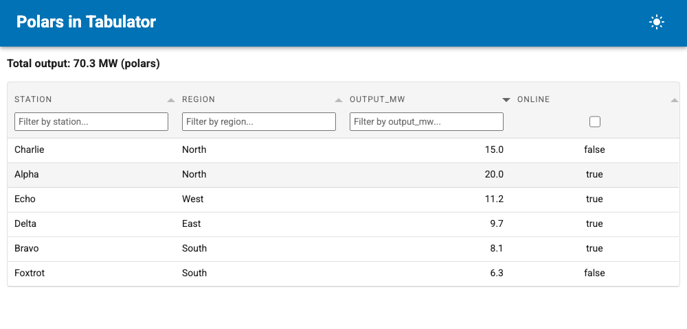

</img>

## What is Panel?

[Panel](https://panel.holoviz.org/) is an open-source Python library for building tools, dashboards and complex applications entirely in Python. It comes with the PyData ecosystem, advanced data tables and much more built in, and offers both high-level reactive APIs and lower-level callback-based APIs, so you can put together an exploratory app in a few lines or develop a multi-page application with rich interactivity. Panel is a member of the [HoloViz](https://holoviz.org) ecosystem, alongside a suite of tools designed for data exploration.

## New Release!

We are happy to announce the 1.11.0 release of Panel! Panel 1.10 changed how you build Panel apps with `pn.ui`. This release makes those apps, and the classic ones, faster. We spent a large part of the cycle profiling real applications and removing fixed costs from every page load, session, component and event. The same app, unchanged, now loads a fraction of the bytes, starts sessions faster and answers events in less than half the time, and param 2.5 and panel-material-ui 0.17, released alongside it, add to these gains. `Tabulator` and the other data components now also work with Polars, PyArrow and other DataFrame libraries, which let us make pandas an optional dependency, and the release fixes a long list of bugs, including several affecting authentication and apps deployed behind a reverse proxy.

Many thanks to @fizzbeom and @morgan-coded for responsibly reporting the security issues fixed in this release, and to the contributors to this release: @philippjfr, @hoxbro, @maximlt, @aarab-malik, @AaryanRS, @benjibunbun, @Cherith1222, @chiruu12, @Jojoussef, @SAMARTHJAISWAL, @Web4everyone32, @YashAnand69, @Adithya6721, @Adititodekar, @ahuang11, @Alpenj, @compiler-segfault, @danishkumar26, @JoeyTan21, @Kkkakania, @MarcSkovMadsen, @mmporong, @mvanhorn, @nightcityblade, @nojaf, @prabhushreyas, @ryandesign, @SuMayaBee, @sushan5140 and @tmichela.

<hr>

If you're using [Anaconda](https://www.anaconda.com/downloads), you can install the latest version of Panel with `conda install panel`. If you prefer pip, use `pip install panel`. Note that pip no longer installs pandas for you; use `pip install "panel[recommended]"` if you want it. To also get the new param and panel-material-ui releases, upgrade them together, e.g. `pip install -U panel param panel-material-ui`.

<hr>

## Performance

Panel 1.11 removes a lot of fixed cost from serving an app: in the bytes a page loads, in the work done for each session and component, and in the overhead around each event. You get all of it without changing any code.

To see what that means for a real app, we built the same dashboard twice, once from classic components in a `FastListTemplate` and once from Material components in a `pn.ui.Page`. Each has around 180 components: 40 widgets in the sidebar, a row of indicators, a Bokeh plot, a 1,000 row `Tabulator`, some Markdown and a card with 120 more widgets. We served both with Panel 1.10.1 and 1.11.0 and measured them in headless Chromium, alongside a few Python-side scenarios around large layouts and tables. Panel 1.11 works with param 2.4 and panel-material-ui 0.16 as well as with the new param 2.5 and panel-material-ui 0.17, so the chart shows it with both. The measured times for every scenario are in the [appendix](#appendix-benchmark-results).

</img>

The biggest change on page load is the amount of data. MathJax used to be loaded by every template page and is now only loaded when a page contains math, templates no longer load their resources twice, and responses are gzipped ([#9058](https://github.com/holoviz/panel/pull/9058)). Our benchmark runs on localhost, so it barely shows in the load time, but over a real network the drop from 5.5 MB to 1 MB matters much more. Versioned resources also get long-lived cache headers, so the browser reuses them without asking the server again.

Creating a session is where every user waits before seeing anything, and it also limits how many users a single server process can handle. Caching the per-request resource bookkeeping ([#9068](https://github.com/holoviz/panel/pull/9068)), cheaper Bokeh model creation ([#9064](https://github.com/holoviz/panel/pull/9064)) and cheaper component construction ([#9069](https://github.com/holoviz/panel/pull/9069)) speed up every app. Material components benefit most, because `JSComponent` and `ReactComponent` now compute their per-class information once instead of for every instance and skip properties that are still at their defaults ([#9067](https://github.com/holoviz/panel/pull/9067), [#9095](https://github.com/holoviz/panel/pull/9095)). That roughly triples how many Material sessions a server can create per second.

The round trip measures how long it takes from a change in the browser until the update made by a Python callback arrives back. On a fresh server it went from 54 ms to 23 ms on the classic page and from 67 ms to 23 ms on the Material page. 1.10 also got slower the longer a server ran: after the session benchmark had loaded the page 63 times without opening a websocket, as health checks and abandoned page loads do, every event on the Material page took more than 400 ms, while 1.11 stays at 23 ms. Busy-state bookkeeping and in-place pane updates got much cheaper, a widget value change no longer unlocks and relocks every parameter of the widget ([#9158](https://github.com/holoviz/panel/pull/9158)), and Panel now waits 20 ms instead of 50 ms for further changes before processing an event from the browser ([#9066](https://github.com/holoviz/panel/pull/9066)). Appending to or replacing children of a large layout, which chat apps and logs do all the time, no longer scales with the number of children already there ([#9057](https://github.com/holoviz/panel/pull/9057), [#9160](https://github.com/holoviz/panel/pull/9160), [#9162](https://github.com/holoviz/panel/pull/9162)), and `Tabulator` updates on large tables no longer reprocess or resend the whole table ([#9071](https://github.com/holoviz/panel/pull/9071)). In the browser, `Tabulator` now applies `stream`, `patch` and selection changes to the existing table instead of rebuilding it ([#9065](https://github.com/holoviz/panel/pull/9065)).

A few other improvements are not in the benchmarks: `pn.cache` hits are more than ten times cheaper ([#9063](https://github.com/holoviz/panel/pull/9063)), `Vega` and `Plotly` panes avoid redundant re-renders ([#9061](https://github.com/holoviz/panel/pull/9061)), and Documents cleaned up without a session, such as those created by health checks, no longer stay in memory forever ([#9059](https://github.com/holoviz/panel/pull/9059)).

All numbers are medians over 5 runs of the served benchmarks (each on a fresh server, with the 40 round trips in each run also reduced to their median) and 7 runs of the Python-side ones. We ran them on an Apple M5 Pro with Python 3.14.4 and Bokeh 3.10.2, comparing Panel 1.10.1 with param 2.4.2 and panel-material-ui 0.16.7 against Panel 1.11.0, once with the same param and panel-material-ui and once with param 2.5 and panel-material-ui 0.17, measured with param 2.5.0rc0 and panel-material-ui 0.17.0rc4. The page loads and fresh-server round trips come from a separate run, without the session benchmark beforehand, with panel-material-ui built from its main branch shortly before the release, which includes the MUI 9.6 update. The scripts are in the [`benchmarks`](https://github.com/holoviz-dev/blog/tree/main/posts/panel_release_1.11/benchmarks) folder next to this post if you want to reproduce them.

## param 2.5 and panel-material-ui 0.17

We are releasing param 2.5 and panel-material-ui 0.17 alongside Panel 1.11, and both add to these gains. You get everything above with the param and panel-material-ui you already have installed, and more once you upgrade them.

[param 2.5.0](https://param.holoviz.org/releases.html), the library underneath every Panel component, makes the hot paths of parameters cheaper. Reading a `Number` parameter is about 2.4× faster and setting one that triggers watchers about 2.2× faster ([param#1167](https://github.com/holoviz/param/pull/1167)), and old and new values are compared once per event instead of once per watcher ([param#1234](https://github.com/holoviz/param/pull/1234)). Every widget value, layout change and pane update goes through these paths, so the whole of Panel benefits. The release also adds `param.Model`, which builds parameters from type annotations, and a `DataFrameLike` parameter for any DataFrame supported by Narwhals.

[panel-material-ui 0.17.0](https://panel-material-ui.holoviz.org/releases.html) focuses on what Material components cost under load:

* Streaming into `ChatMessage` and `ChatFeed` no longer re-syncs the whole page on every token. Streaming 500 tokens into the last message of a 500 message feed went from about 20 s to 0.2 s.
* Widgets are constructed up to twice as fast, and setting `TextInput.value` on a rendered widget is twice as fast.
* `Select`, `MultiChoice`, `CrossSelector` and `AutocompleteInput` process their options in linear time, so re-rendering a `Select` with 50,000 options went from about 2.7 s to 30 ms.
* Switching the active tab of a dynamic `Tabs` or `Accordion` is four to five times faster, and switching dark mode takes a single message instead of a round trip per component.
* `Page` and the notification area no longer leak, which also made every callback slower the more pages had been created.

In our benchmarks the two releases together bring Material session creation from 127 ms to 112 ms, raise the number of Material sessions a server creates per second from 7.6 to 8.3, cut rendering a `pn.ui.Column` of 200 widgets from 106 ms to 94 ms and the first Material page load from 834 ms to 707 ms. Classic apps change little, as you would expect.

## Any DataFrame, and optional pandas

Panel 1.10 taught the `DataFrame` pane to render any DataFrame supported by [Narwhals](https://narwhals-dev.github.io/narwhals/). In 1.11 the interactive data components follow: `Tabulator`, the `DataFrame` widget, `Perspective` and `Vizzu` accept Polars, PyArrow and any other eager DataFrame Narwhals supports, without converting it to pandas ([#8841](https://github.com/holoviz/panel/pull/8841)). Filtering, sorting, remote pagination, selection, edits, `stream()` and `patch()` all work, and `.value` stays the type you passed in:

```python
import panel as pn
import polars as pl

df = pl.DataFrame({
    'station': ['Alpha', 'Bravo', 'Charlie', 'Delta', 'Echo', 'Foxtrot'],
    'region': ['North', 'South', 'North', 'East', 'West', 'South'],
    'output_mw': [12.4, 8.1, 15.0, 9.7, 11.2, 6.3],
    'online': [True, True, False, True, True, False],
})

table = pn.ui.Tabulator(
    df,
    header_filters=True,
    sorters=[{'field': 'output_mw', 'dir': 'desc'}],
    layout='fit_columns',
    sizing_mode='stretch_width',
)

total = pn.ui.Typography(variant='h6')

def update_total(event=None):
    total.object = f"Total output: {table.value['output_mw'].sum():.1f} MW ({type(table.value).__module__.split('.')[0]})"

table.on_edit(update_total)
update_total()

pn.ui.Page(title='Polars in Tabulator', main=[total, table]).servable()
```

</img>

*After editing Alpha's output to 20, the total is recomputed from the Polars frame.*

Since these frames have no index, rows are addressed by position, and `Styler` based styling remains pandas-only; the [Tabulator reference](https://panel.holoviz.org/en/docs/latest/reference/widgets/Tabulator.html) has the details. With nothing in Panel's core depending on pandas any more, it has moved to the `recommended` extra, as announced in the 1.9 release notes. If your app uses pandas, make sure it is in your own requirements.

## Bug fixes

This release contains around a hundred bug fixes. Two groups deserve a mention because they affect how apps are deployed.

Authentication got several fixes. The login redirect validation now rejects `next` values such as `///evil.com`, which browsers resolve to another site, closing an open redirect in both the basic auth and OAuth login flows ([#8938](https://github.com/holoviz/panel/pull/8938)); we recommend upgrading if you use authentication. 1.11 also includes the two security fixes released in 1.10.1 and 1.9.5: the server no longer imports the module named in a `/components/` resource URL, which let any client stop the server with a single request ([GHSA-wfhv-r23p-8x9w](https://github.com/holoviz/panel/security/advisories/GHSA-wfhv-r23p-8x9w)), and `authorize_callback` now also applies to `autoload.js` and websocket connections, so a user denied access to an app can no longer open a session of it ([GHSA-9cgh-cwhr-4rhg](https://github.com/holoviz/panel/security/advisories/GHSA-9cgh-cwhr-4rhg)). OAuth behind a reverse proxy or with `--prefix` used to need a hand-written `--oauth-redirect-uri`, and some setups did not work at all. Panel now derives the external URL from the request, `--root-path`, `--prefix` and, with `--use-xheaders`, the `X-Forwarded-Host` and `X-Forwarded-Prefix` headers, and uses it for the redirect URI and every login and logout redirect ([#9072](https://github.com/holoviz/panel/pull/9072), building on [#8211](https://github.com/holoviz/panel/pull/8211) by [@TheoMathurin](https://github.com/TheoMathurin)). `--oauth-guest-endpoints` entries ending in `/*` now cover the paths below them, so a branded login page can load its assets ([#9033](https://github.com/holoviz/panel/pull/9033)), and Panel warns when the session token gets close to the 8 KB header limit of common proxies, which otherwise surfaced only as "Could not open websocket" in the browser ([#8638](https://github.com/holoviz/panel/pull/8638)).

Resource loading behind proxies and on nested routes is also fixed. Stylesheets defined relative to a design or theme were cached with the URL of whichever route rendered them first, so a page on a nested route such as `/dash/<id>` requested them from the wrong place and got a 404. Lazily loaded resources had the same problem after navigating within an app under `panel serve`. Both now resolve against the route the session is on, including behind a proxy that strips its prefix ([#9109](https://github.com/holoviz/panel/pull/9109)). Hosts that rewrite or do not serve Panel's `static/extensions/` routes, such as Shiny, now load components too, falling back to the CDN when a resource request fails ([#9020](https://github.com/holoviz/panel/pull/9020)).


Beyond those, threaded apps no longer hit races on the document lock, updates made inside a long running synchronous callback reach the browser while it runs again, notebooks sync every change of a message, and `Tabulator`, `Plotly`, `FloatPanel`, `Tabs` and the classic templates received many smaller fixes. The changelog below has the full list.

## Upgrading

A few changes may need your attention. `pip install panel` no longer installs pandas. The default OAuth redirect URI now includes `--prefix` and follows the forwarded headers with `--use-xheaders`, so you may have to register the new URI with your provider or pass the old one with `--oauth-redirect-uri`. Responses are now gzipped (turn it off with `pn.serve(..., compress=False)` if your proxy already compresses), and changes from the browser are debounced for 20 ms instead of 50 ms. The [upgrade guide](https://panel.holoviz.org/en/docs/latest/upgrade.html) and the behaviour change markers in the changelog cover the rest.

## Panel and AI

The chat components benefit from the performance work, and streaming text with math into a `Markdown` pane now typesets only the blocks that changed ([#9061](https://github.com/holoviz/panel/pull/9061)). `ChatInterface` gained a `widget_placeholder` parameter ([#9040](https://github.com/holoviz/panel/pull/9040)). If you use an AI coding assistant to write Panel code, point it at our [`llms.txt`](https://panel.holoviz.org/en/docs/latest/llms.txt), which indexes Markdown versions of every documentation page, or install the [HoloViz Agent Skills](https://skills.holoviz.org/) with `uvx holoviz-skills@latest install`. The guide on [using Panel with an AI assistant](https://panel.holoviz.org/en/docs/latest/how_to/use_llms.html) covers both.

## What comes next

We now have benchmarks for page loads, sessions, components, layouts, `Tabulator` and caching, so we can keep measuring as we go, and we will keep chipping away at the remaining costs. Panel 2.0, where the Material components become the default, stays the larger goal. If you have questions or want to share what you built, join us on [Discourse](https://discourse.holoviz.org/) or [Discord](https://discord.gg/AXRHnJU6sP), and please report bugs and ideas on [GitHub](https://github.com/holoviz/panel/issues).

## Changelog

For the full list of changes, see the [Panel 1.11.0 changelog](https://github.com/holoviz/panel/releases/tag/v1.11.0).

### 🚀 Features

* Accept Polars, PyArrow and any other eager DataFrame supported by Narwhals in `Tabulator`, the `DataFrame` widget, `Perspective` and `Vizzu` without converting it to pandas. Filtering, sorting, remote pagination, selection, edits, `stream()` and `patch()` all work on these frames, with rows addressed by position since they have no index, and PyArrow tables keep `large_string` and other large column types when they are edited, patched or streamed into ([#8841](https://github.com/holoviz/panel/pull/8841), [#9086](https://github.com/holoviz/panel/pull/9086))

### ✨ Enhancements

* Accept positional arguments to the cached function in `pn.state.as_cached` ([#9123](https://github.com/holoviz/panel/pull/9123))
* Show a default `Filter by <column>...` placeholder in `Tabulator` header filters ([#8452](https://github.com/holoviz/panel/pull/8452))
* Add a `widget_placeholder` parameter to `ChatInterface` that sets, and later updates, the placeholder of its default input widget ([#9040](https://github.com/holoviz/panel/pull/9040))
* Add `max_completions` to `AutocompleteInput` to limit the number of suggestions shown ([#9031](https://github.com/holoviz/panel/pull/9031))
* Let `save` export PNGs with Bokeh's Playwright backend, selected with the new `backend` argument (e.g. `.save('x.png', backend='playwright')`) or `BOKEH_EXPORT_BACKEND`, and apply Panel's page template and idle wait to screenshots again on Bokeh 3.10 ([#8918](https://github.com/holoviz/panel/pull/8918))
* Add a `compress` option to `pn.serve` and `get_server` (default `True`) to turn off response compression, for example behind a proxy that already compresses ([#9058](https://github.com/holoviz/panel/pull/9058))
* Let `--oauth-guest-endpoints` entries ending in `/*` or `/` cover the paths below them, so e.g. a branded login page can load its logo from `--static-dirs`; plain entries now match the path without the query string but still do not cover sub-paths ([#9033](https://github.com/holoviz/panel/pull/9033))
* Log a one-time warning per app when the Bokeh session token approaches the 8 KB request header limit of common proxies, which otherwise fails with an unexplained "Could not open websocket" ([#8638](https://github.com/holoviz/panel/pull/8638))
* Load the `TextEditor` (Quill) resources from the CDN configured with `PANEL_NPM_CDN` instead of always from jsDelivr ([#7826](https://github.com/holoviz/panel/pull/7826))
* Add `keyboard_accessible` and `soft_wrap` parameters to `CodeEditor`, so keyboard users can move focus out of the editor and long lines can wrap ([#9120](https://github.com/holoviz/panel/pull/9120))
* Add a `markers` parameter to `CodeEditor` to highlight lines, and style its read-only tooltip ([#9139](https://github.com/holoviz/panel/pull/9139))

### ⚡ Performance

This release removes much of the fixed cost of serving a Panel app, from the bytes a page loads to the work done per session, per component and per event. The numbers below are the ones measured in each pull request.

* Load fewer resources per page and serve them compressed and cached. MathJax is only loaded on pages that contain math, template resources are no longer loaded twice, responses are gzipped, static files are compressed once and versioned resources get long-lived cache headers. A `FastListTemplate` page went from 5831 KB to 3143 KB of local resources, 830 KB on the wire ([#9058](https://github.com/holoviz/panel/pull/9058))
* Cache the per-request resource bookkeeping, apply a template's design once and stop streaming log records into the admin dashboard when nobody is looking; generating the page for a 200-widget app went from 16.1 ms to 1.3 ms ([#9068](https://github.com/holoviz/panel/pull/9068))
* Speed up Bokeh model creation in `server_doc`; a `Column` of 200 widgets went from 173 ms to 104 ms ([#9064](https://github.com/holoviz/panel/pull/9064))
* Cut the cost of constructing Panel components and of `pn.panel` dispatch; a `Column` of 20 sliders is 47% cheaper to create and `pn.panel('text')` 42% cheaper ([#9069](https://github.com/holoviz/panel/pull/9069))
* Make `JSComponent` and `ReactComponent`, and with them every `panel-material-ui` component, cheap to render and update; `server_doc` of a `ui.Column` of 200 widgets went from 534 ms to 335 ms and appending to a `ui.Column(2000)` from 167 ms to 13.7 ms ([#9067](https://github.com/holoviz/panel/pull/9067), [#9099](https://github.com/holoviz/panel/pull/9099))
* Further reduce the cost of creating `ReactiveESM` models, such as those of `panel-material-ui` components, by dropping default-valued properties when constructing the model and its DataModel, narrowing the reference scan of DataModel properties, registering event callbacks without a per-callback signature inspection and reusing the Document's shared stylesheets instead of building a throwaway per component; `server_doc` of a `ui.Column` of 200 components went from 124 ms to 86 ms with an unchanged serialized Document ([#9095](https://github.com/holoviz/panel/pull/9095))
* Send a compiled inline ESM bundle once per document instead of once per component, so ten `panel-material-ui` buttons in a notebook or exported HTML file go from 15 MB to 1.7 MB ([#9104](https://github.com/holoviz/panel/pull/9104))
* Make mutations of large layouts cheap; appending to a `Column` with 2000 children went from 89.1 ms to 10.9 ms ([#9057](https://github.com/holoviz/panel/pull/9057))
* Share the loading indicator CSS across all models on a Document instead of sending a copy per model, shrinking the initial document of a `Column` of 200 widgets from 126.7 KB to 74.5 KB (-41%) ([#9056](https://github.com/holoviz/panel/pull/9056))
* **Behaviour change:** Cut the per-event overhead in the server and notebook update paths and lower the default debounce of frontend changes from 50 ms to 20 ms; the browser to Python to browser round trip on the benchmark app dropped from a median of ~64 ms to ~34 ms. `pn.reactive.Syncable._debounce` can still be raised globally or per component ([#9066](https://github.com/holoviz/panel/pull/9066))
* Batch model updates scheduled from worker threads into one message and combine held events in linear time; a 1 ms periodic callback with `PANEL_NUM_THREADS=4` went from 299–390 to 603–682 ticks/s, and setting `TextInput.value` sends one message instead of two ([#9070](https://github.com/holoviz/panel/pull/9070))
* Process events that arrive while changes are still pending on a worker thread with the document lock, so a synchronous callback no longer blocks the event loop and its updates reach the browser while it runs ([#9075](https://github.com/holoviz/panel/pull/9075))
* Avoid redundant work on `Vega`, `HTML`, `Markdown` and `Plotly` pane updates: Vega data updates no longer re-embed the chart (mean latency 46.5 ms -> 22 ms), streaming 200 chunks containing math into `Markdown` went from 3665 ms to 465 ms of JS time, and a Plotly layout change made in the browser from 269 ms to 6 ms ([#9061](https://github.com/holoviz/panel/pull/9061))
* Update `Tabulator` incrementally in the browser on `stream`, `patch` and selection instead of rebuilding the table; a one-cell `patch` on 10k rows went from 15.3 ms to 0.4 ms of JS handler time ([#9065](https://github.com/holoviz/panel/pull/9065))
* Cut the Python-side cost of `Tabulator` updates on large tables; on 200k rows a remote pagination page change went from 13.9 ms to 1.2 ms and a one-cell `patch()` with a sorter active from 27.6 ms and a 6.3 MB message to 2.1 ms and a 1 KB message. Also fixes `patch()` with remote pagination ([#9071](https://github.com/holoviz/panel/pull/9071))
* Stop rebuilding every `Tabulator` column on each edit when column names are not strings (e.g. years after a pivot), which also closed the editor when tabbing to the next cell ([#9054](https://github.com/holoviz/panel/pull/9054))
* **Behaviour change:** Reduce `pn.cache` per-call overhead (a hit on `f(1)` went from 22.5 µs to 1.4 µs), give decorations with different settings separate caches and let an exact type in `hash_funcs` take precedence over the defaults. Hashes of flat containers change, so existing `to_disk=True` caches are recomputed once ([#9063](https://github.com/holoviz/panel/pull/9063))
* Release Documents cleaned up without a session (liveness checks, warm-up, the ASGI server) and cut references from models to their Document when it is destroyed, so they no longer stay alive forever ([#9059](https://github.com/holoviz/panel/pull/9059))
* Only unlock the parameters that are actually readonly or constant when syncing a widget value, instead of toggling every parameter of the widget; setting a value from Python is 2.9× faster for a classic `IntSlider` and 1.7× for `pn.ui.IntSlider`, and a value change from the browser about 1.9× faster. Also stops a constant parameter from staying writable on an instance after it was set inside `edit_readonly` ([#9158](https://github.com/holoviz/panel/pull/9158))
* Read the sizing properties of a layout's children without Bokeh's theme lookup, making the sizing inference on each layout change about 2.7× cheaper ([#9160](https://github.com/holoviz/panel/pull/9160))
* Skip the full-tree preprocessing walks on layout changes that do not add the components they handle (HoloViews, ECharts, param methods); appending to a `Column` of 500 items is 13 to 14% faster ([#9162](https://github.com/holoviz/panel/pull/9162))

### 🔒 Security

* Reject `next_url` values such as `///evil.com` or ones containing control characters, which browsers resolve to another site, in the basic auth and OAuth login redirects ([#8938](https://github.com/holoviz/panel/pull/8938))
* Stop importing the module named in `/components/` resource URLs, which let any client, including when authentication is enabled, make the server import installed modules and shut it down with a single request ([GHSA-wfhv-r23p-8x9w](https://github.com/holoviz/panel/security/advisories/GHSA-wfhv-r23p-8x9w))
* Apply `authorize_callback` to `autoload.js` and websocket connections, which previously let a logged-in user open a session of an app they were denied access to ([GHSA-9cgh-cwhr-4rhg](https://github.com/holoviz/panel/security/advisories/GHSA-9cgh-cwhr-4rhg), [#9152](https://github.com/holoviz/panel/pull/9152))
* Stop `FileSelector` from navigating into sibling directories whose name starts with the name of `root_directory`, such as `/app/data2` for a root of `/app/data` ([#9149](https://github.com/holoviz/panel/pull/9149))

### 🐛 Bug Fixes

* Send updates made inside a long running synchronous callback to the browser while it runs instead of only once it returns, so e.g. a loading spinner toggled in the callback shows again, on Tornado as well as the ASGI servers ([#8937](https://github.com/holoviz/panel/pull/8937), [#9082](https://github.com/holoviz/panel/pull/9082))
* Only treat the document lock as held by the thread that acquired it, fixing `RuntimeError: _pending_writes should be non-None` and concurrent document writes in threaded apps (`--num-threads`), including on free-threaded Python 3.14, and only let the lock owner write updates directly from a worker thread ([#9008](https://github.com/holoviz/panel/pull/9008), [#9009](https://github.com/holoviz/panel/pull/9009), [#9024](https://github.com/holoviz/panel/pull/9024))
* Keep a script that ends right after `pn.serve(..., threaded=True)` serving, which since 1.10.0 answered every request with a 500 error ([#9073](https://github.com/holoviz/panel/pull/9073))
* Fix several timing issues: Plotly clicks and hovers right after render being dropped, quick `Tabs` switches leaving broken views, timers scheduled from worker threads firing late, a `Tabulator` scroll right after render being reset, `PeriodicCallback.start()` busy looping, and threaded servers leaking sockets on Windows ([#8869](https://github.com/holoviz/panel/pull/8869))
* Sync every property change of a message sent from the browser in notebooks, where only the first one reached Python, so e.g. `pn.state.browser_info` and `FileInput` `filename` and `mime_type` are populated ([#9045](https://github.com/holoviz/panel/pull/9045))
* Stop notebooks from echoing changes made in Python back to Python, which caused `BokehUserWarning: reference already known` warnings ([#9055](https://github.com/holoviz/panel/pull/9055))
* Stop sending a change made in the browser back to that browser when it arrives while the Document is held, e.g. by a callback running on a worker thread, which on high-latency deployments reset text inputs to stale text and lost the characters typed since ([#9101](https://github.com/holoviz/panel/pull/9101))
* Write changes from unlocked callbacks, such as an async task streaming into a chat message, after the changes of a callback holding the document lock when they refer to models that callback has not sent yet, instead of writing them first so the browser dropped them with `reference ... isn't known`; unrelated changes are still written immediately ([#9105](https://github.com/holoviz/panel/pull/9105), [#9107](https://github.com/holoviz/panel/pull/9107))
* Write the changes of a locked callback that are handed to Bokeh, e.g. when a `hold()` block exits while the socket is busy, as one message instead of one per change, so the browser no longer renders them in steps ([#9106](https://github.com/holoviz/panel/pull/9106))
* Keep every view of a notebook output responsive when the output is shown more than once, e.g. with JupyterLab's "Create New View for Cell Output" ([#9062](https://github.com/holoviz/panel/pull/9062))
* Fix `MultipleInstanceError` from `Kernel.instance()` (e.g. in ipyleaflet) after loading the `ipywidgets` extension, while still resolving the per-session kernel when serving ipywidgets from a notebook or the Jupyter preview, and render the first ipywidget of a served app reliably ([#8949](https://github.com/holoviz/panel/pull/8949), [#9025](https://github.com/holoviz/panel/pull/9025), [#9074](https://github.com/holoviz/panel/pull/9074))
* **Behaviour change:** Make OAuth and login redirects work behind a reverse proxy or with `--prefix` without `--oauth-redirect-uri`, honouring `X-Forwarded-Host` and `X-Forwarded-Prefix` with `--use-xheaders`. The default OAuth redirect URI now includes `--prefix` and follows those headers, so re-register it with your provider or pass `--oauth-redirect-uri` ([#9072](https://github.com/holoviz/panel/pull/9072), building on [#8211](https://github.com/holoviz/panel/pull/8211) by @TheoMathurin)
* **Behaviour change:** Leave hierarchical `Tabulator` group rows blank for index levels without an aggregator instead of summing every column (and concatenating strings). Pass `aggregators` explicitly, e.g. `aggregators={'grp': 'sum'}`, to keep the previous sums ([#9004](https://github.com/holoviz/panel/pull/9004), [#9011](https://github.com/holoviz/panel/pull/9011))
* Fix `Tabulator.stream` on a table whose index is a `DatetimeIndex` or another non-numeric index, preserving the streamed index labels so repeated streams and subsequent patches work ([#8858](https://github.com/holoviz/panel/pull/8858), [#9023](https://github.com/holoviz/panel/pull/9023))
* Convert `datetime`, `pd.Timestamp` and `np.datetime64` values in `Tabulator.patch`, which previously raised or wrote the wrong value ([#9000](https://github.com/holoviz/panel/pull/9000))
* Support clearing a cell in a nullable integer (`Int64`) `Tabulator` column, which now stores `<NA>` and keeps the dtype ([#8994](https://github.com/holoviz/panel/pull/8994))
* Re-fit `Tabulator` columns with a `fit_data` layout after a cell edit or a new `value`, so longer content no longer clips; columns the user resized keep their width ([#8968](https://github.com/holoviz/panel/pull/8968))
* Let a `Tabulator` date header filter with `func='like'` match the timestamp text instead of raising, with remote pagination and in `current_view` ([#8857](https://github.com/holoviz/panel/pull/8857))
* Apply `Tabulator.style` cell styles to the right column when `groups` are set ([#8966](https://github.com/holoviz/panel/pull/8966))
* **Behaviour change:** Ignore the `width` that a pandas `Styler` (e.g. `Styler.bar`) sets on `Tabulator` cells, which made the column wider than its header; use `Tabulator.widths` to size columns ([#8988](https://github.com/holoviz/panel/pull/8988))
* Stop highlighting rows on hover when `Tabulator` has `selectable=False` ([#8955](https://github.com/holoviz/panel/pull/8955))
* Support `Tabulator.jscallback(selection=...)` and raise a clear error when a `jscallback` targets a parameter that only exists in Python ([#8953](https://github.com/holoviz/panel/pull/8953))
* Stop a `Tabulator` in an inactive tab from keeping the browser's main thread busy ([#8936](https://github.com/holoviz/panel/pull/8936))
* Fix `Perspective.stream()` duplicating rows in the browser, make dict patches to `Perspective` update `.object`, and stop truncating edited Polars string values ([#8841](https://github.com/holoviz/panel/pull/8841))
* Keep datetime axes of a `Plotly` pane as dates after `update_traces` or `batch_update` ([#8952](https://github.com/holoviz/panel/pull/8952))
* Fix the serialization error that dropped `Plotly` updates made inside `fig.batch_update()` ([#8943](https://github.com/holoviz/panel/pull/8943))
* Include multicategory `x` values and heatmap and image `pointNumber`/`pointIndex` in `Plotly` click, hover and selection data ([#8954](https://github.com/holoviz/panel/pull/8954))
* Play animated `Plotly` figures by keeping their frames, also when the figure is given as a dict ([#9043](https://github.com/holoviz/panel/pull/9043))
* **Behaviour change:** Render `Matplotlib` PNGs at twice the `dpi` when `high_dpi=True` (the default), as before Panel 1.0, so they are sharp on high-DPI screens at the same displayed size; PNGs are about 2-3x larger and `high_dpi=False` restores the previous output ([#9047](https://github.com/holoviz/panel/pull/9047))
* Render Matplotlib plots in a `HoloViews` pane, e.g. of a `HoloMap` or `DynamicMap`, at the DPI of the HoloViews renderer, so they are no longer twice the size of the same plot rendered by HoloViews directly ([#9049](https://github.com/holoviz/panel/pull/9049))
* **Behaviour change:** Apply the `theme` of a `Bokeh` pane in served apps, notebooks and saved files by setting it on the document, as `HoloViews.theme` does, so it now applies to the whole document ([#8996](https://github.com/holoviz/panel/pull/8996))
* Style `Segment` glyphs, such as box plot whiskers, in the dark Bokeh themes so they are visible ([#8980](https://github.com/holoviz/panel/pull/8980))
* Load the full KaTeX stylesheet and bundle its fonts for the `LaTeX` pane, so constructs such as `\hline` render correctly ([#8965](https://github.com/holoviz/panel/pull/8965))
* Stop the `Markdown` pane from parsing `*` inside `$$...$$` math as emphasis, including while streaming ([#8970](https://github.com/holoviz/panel/pull/8970), [#9014](https://github.com/holoviz/panel/pull/9014))
* Stop an `HTML` or `Markdown` pane from throwing when its visibility changes before it is rendered, e.g. inside a collapsed `panel-material-ui` `Card` ([#9051](https://github.com/holoviz/panel/pull/9051))
* Support Altair's `vegafusion` data transformer in the `Vega` pane ([#8939](https://github.com/holoviz/panel/pull/8939))
* Render local PDF data in the `PDF` pane with `embed=False` in Chromium ([#8995](https://github.com/holoviz/panel/pull/8995))
* Keep the per-row structure of nested columns, such as `PathLayer` paths, in `DeckGL` data ([#8982](https://github.com/holoviz/panel/pull/8982))
* Generate Material UI widgets in `pn.ui.HoloViews`, and design-specific widgets in `pn.pane.HoloViews`, as intended ([#8976](https://github.com/holoviz/panel/pull/8976))
* Keep one `HoloViews` slider option per `HoloMap` key when formatted labels collide, so every frame can be selected ([#8984](https://github.com/holoviz/panel/pull/8984))
* Accept `pn.ui` layouts for `HoloViews.widget_layout` and `ChatReactionIcons.default_layout` ([#8932](https://github.com/holoviz/panel/pull/8932))
* Allow non-string values in `AutocompleteInput` with `restrict=False` ([#8909](https://github.com/holoviz/panel/pull/8909))
* Allow setting the `value` of `TextInput`, `TextAreaInput` and `PasswordInput` to `None` ([#8917](https://github.com/holoviz/panel/pull/8917))
* Show the default colour (`#000000`) when the `value` of a `ColorPicker` is set to `None`, instead of raising a validation error ([#9098](https://github.com/holoviz/panel/pull/9098))
* Allow `fixed_start` or `fixed_end` to be `None` on editable sliders, e.g. when generated by `pn.Param` for a parameter with one open bound, instead of raising a `TypeError` ([#9103](https://github.com/holoviz/panel/pull/9103))
* Select the right option in a `Select` with `groups` when the same label appears in several groups ([#8956](https://github.com/holoviz/panel/pull/8956))
* Select the right option when a `Select` synced to the URL has numeric-looking options such as `'02'` ([#8960](https://github.com/holoviz/panel/pull/8960))
* Fix validation of `DatetimeInput` when only `start` or `end` is set ([#8910](https://github.com/holoviz/panel/pull/8910))
* Show a rounded value (e.g. `0.1` instead of `0.10000000001`) in the `EditableFloatSlider` textbox when no `format` is given, and apply later `format` and `step` changes to it ([#8990](https://github.com/holoviz/panel/pull/8990))
* **Behaviour change:** Round `interact` slider defaults that fall between steps to the nearest step instead of flooring them, so `(0, 4, 0.5, 1.3)` now starts at `1.5` ([#8947](https://github.com/holoviz/panel/pull/8947), [#9013](https://github.com/holoviz/panel/pull/9013))
* Render a `None` value in `LinearGauge` like `nan` instead of raising a `TypeError` ([#9039](https://github.com/holoviz/panel/pull/9039))
* Size the animated stripes of an active `Progress` bar to its height ([#8981](https://github.com/holoviz/panel/pull/8981))
* Respect `max_width` and `max_height` when sizing the `Dial` ([#8958](https://github.com/holoviz/panel/pull/8958))
* Accept any `os.PathLike`, such as an `os.DirEntry` from `os.scandir`, as the `file` of a `FileDownload` ([#9090](https://github.com/holoviz/panel/pull/9090))
* Render bounded `param.DateRange` and `param.CalendarDateRange` parameters without a default in `Param` instead of failing to load the page ([#8859](https://github.com/holoviz/panel/pull/8859))
* Use an input widget for bounded `param.Number` and `param.Integer` parameters whose value is `None`, which previously failed to render ([#8983](https://github.com/holoviz/panel/pull/8983))
* Fix updating the `objects` of a `param.Selector` holding `Parameterized` instances in `Param` ([#8985](https://github.com/holoviz/panel/pull/8985))
* **Behaviour change:** `Widget.from_param` no longer wraps selectors of `Parameterized` objects in a `Row` with an expand toggle; pass `expand_button=True` to opt back in ([#8991](https://github.com/holoviz/panel/pull/8991))
* Hide a single unpacked `Param` widget when its parameter's `precedence` drops below the display threshold ([#8992](https://github.com/holoviz/panel/pull/8992))
* Update the tab title when a `Tabs` entry is renamed but keeps the same pane ([#8944](https://github.com/holoviz/panel/pull/8944))
* Support param references for `objects` in `Tabs`, `Accordion` and `FloatPanel` ([#8997](https://github.com/holoviz/panel/pull/8997))
* Retain parameters such as `closable` and `tabs_location` when cloning `Tabs` and `Accordion`, clamping `active` to the new objects ([#8999](https://github.com/holoviz/panel/pull/8999), [#9012](https://github.com/holoviz/panel/pull/9012))
* Fix `clone` for components whose read-only parameters were edited with `param.edit_constant` ([#8948](https://github.com/holoviz/panel/pull/8948))
* Size a `FloatPanel` with `contained=False` to its content, while respecting a height set through `config={'panelSize': ...}` ([#8987](https://github.com/holoviz/panel/pull/8987), [#9015](https://github.com/holoviz/panel/pull/9015))
* Make `FloatPanel` children with stretching sizing modes fill the panel height ([#9001](https://github.com/holoviz/panel/pull/9001))
* Let a `pn.ui.Modal` grow to fit wide content and apply an explicit `width` to the dialog ([#9030](https://github.com/holoviz/panel/pull/9030))
* Let `VSpacer` fill the sidebar height in the Fast, Vanilla, React and Bootstrap templates ([#8971](https://github.com/holoviz/panel/pull/8971))
* Paint plots placed in the modal of the Fast templates in Chromium ([#8972](https://github.com/holoviz/panel/pull/8972))
* Size `scale_both` and `scale_height` content, such as responsive HoloViews plots with an `aspect`, in the Fast template ([#8993](https://github.com/holoviz/panel/pull/8993))
* Use the accent colour for the active Bokeh toolbar tool in the Fast templates ([#9002](https://github.com/holoviz/panel/pull/9002))
* Show the slides when `SlidesTemplate` has `main_max_width` set ([#8978](https://github.com/holoviz/panel/pull/8978))
* Show the configured disconnect and ready notifications for templates built outside a session, e.g. before `template.show()` ([#8942](https://github.com/holoviz/panel/pull/8942))
* **Behaviour change:** Fix `ReactiveHTML` components with `'literal'` children failing to render the page, and render literal children as (sanitized) HTML markup rather than only their text content ([#8989](https://github.com/holoviz/panel/pull/8989))
* Detect `++` and `--` assignments to `data.*` in `ReactiveHTML` scripts and no longer mistake comparisons for assignments ([#8998](https://github.com/holoviz/panel/pull/8998))
* Report the correct `event.node` for `ReactiveHTML` callbacks shared between several nodes ([#8962](https://github.com/holoviz/panel/pull/8962))
* Stop a child from disappearing from `pn.ui` layouts when children are swapped in `ReactComponent` ([#8935](https://github.com/holoviz/panel/pull/8935))
* **Behaviour change:** Stop `model.useState` in `ReactComponent` from writing a stale value back over a newer model change, which could e.g. leave a widget stuck loading after `loading = True` followed by `loading = False`. `setValue` now writes to the model synchronously, so a value set through it reaches the server before a `send_msg` sent in the same handler ([#9100](https://github.com/holoviz/panel/pull/9100))
* Set up `jslink` and `jscallback` links on children added to a `JSComponent` or `ReactComponent` layout, e.g. with `pn.ui.Column.extend` ([#9028](https://github.com/holoviz/panel/pull/9028))
* Fix `JSComponent` and `ReactComponent` views that are re-rendered or removed before they mount, which could abort the layout of the whole page (e.g. with `Cannot read properties of undefined (reading 'top_panel')` for a Bokeh figure) or leave every component rendered afterwards blank ([#9081](https://github.com/holoviz/panel/pull/9081))
* Warn instead of raising when `.controls()` cannot link a parameter to a missing model property ([#8979](https://github.com/holoviz/panel/pull/8979))
* **Behaviour change:** Keep the loading indicator of an async `ParamFunction` or `ParamMethod` on until the function completes ([#8946](https://github.com/holoviz/panel/pull/8946))
* **Behaviour change:** Only inherit `Pipeline` stage values from stages on the current route, so values from abandoned branches no longer leak into a stage ([#8986](https://github.com/holoviz/panel/pull/8986))
* Serve applications whose name or route contains non-ASCII characters, and show their decoded names on the index page ([#8950](https://github.com/holoviz/panel/pull/8950), [#9017](https://github.com/holoviz/panel/pull/9017))
* Honor `pn.config.admin_endpoint` and `PANEL_ADMIN_ENDPOINT` ([#8945](https://github.com/holoviz/panel/pull/8945))
* Open a single browser tab when serving with `num_procs > 1` and `show=True` ([#8963](https://github.com/holoviz/panel/pull/8963))
* Mount WSGI apps such as Flask at their route and `prefix` so their routes resolve ([#8967](https://github.com/holoviz/panel/pull/8967))
* Change the ETag of a file served with `--static-dirs` when the file is rewritten, so browsers no longer keep a stale copy until a hard reload ([#8961](https://github.com/holoviz/panel/pull/8961))
* Read and write user files such as `--setup` scripts, auth templates, `panel convert` output and `panel compile` projects as UTF-8, fixing non-ASCII text on Windows ([#9036](https://github.com/holoviz/panel/pull/9036))
* **Behaviour change:** Only install Panel's SIGINT handler in `get_server` and `pn.serve` when `start=True`; applications that start the event loop themselves should handle SIGINT ([#9003](https://github.com/holoviz/panel/pull/9003))
* Reload the page when `pn.state.location.reload = True` is set while building the app, and no longer reload when it is set to `False` ([#8964](https://github.com/holoviz/panel/pull/8964))
* Give `pn.state.session_info` watchers distinct old and new values and make concurrent updates safe ([#8957](https://github.com/holoviz/panel/pull/8957), [#9016](https://github.com/holoviz/panel/pull/9016))
* Run `Terminal` subprocesses with `exec` so the server's exit handlers no longer run in the forked child ([#8940](https://github.com/holoviz/panel/pull/8940))
* Inline component stylesheets, e.g. for `Tabulator`, when saving with `resources='inline'` ([#8969](https://github.com/holoviz/panel/pull/8969))
* **Behaviour change:** Load lazily loaded component resources on hosts that rewrite or do not serve Panel's `static/extensions/` routes, such as Shiny. A library the host already loaded under a rewritten URL is recognised instead of fetched again, a failed resource request is retried once from the CDN instead of hanging, and ESM components always carry the es-module-shims URL. With `resources='server'`, a page now makes a request to the configured CDN when a `static/extensions/` request fails; a working server never does, and an air-gapped one sees that request fail as well ([#9020](https://github.com/holoviz/panel/pull/9020))
* Only merge embedded widgets that share a label when their type and options also match ([#8974](https://github.com/holoviz/panel/pull/8974))
* Fix `pn.cache` returning the result for a different float with the same hash, such as `-1.0` for `-2.0` ([#8922](https://github.com/holoviz/panel/pull/8922))
* Avoid a `RecursionError` when passing self-referential containers to a `pn.cache` function ([#8923](https://github.com/holoviz/panel/pull/8923))
* Fix typos in `panel compile` messages ([#8880](https://github.com/holoviz/panel/pull/8880))
* Drop held changes to models the client has not been sent yet, which made the browser reject the whole patch with `reference ... isn't known` ([#8906](https://github.com/holoviz/panel/pull/8906), [#9155](https://github.com/holoviz/panel/pull/9155))
* Resize the container of ESM components, including the `panel-material-ui` ones, when their size changes after they rendered ([#9108](https://github.com/holoviz/panel/pull/9108))
* Resolve relative stylesheet urls against the route a session is on, so apps on nested routes load all their stylesheets ([#9109](https://github.com/holoviz/panel/pull/9109))
* Fix serving a Bokeh figure under a global template, which failed with `unexpected attribute 'design' to figure` ([#9110](https://github.com/holoviz/panel/pull/9110))
* Stream into a paginated `Tabulator` without "Scroll Error - Row not visible" errors or stale pages ([#9111](https://github.com/holoviz/panel/pull/9111))
* Stop a `hold()` running on the event loop from leaving the Document in `collect` mode when a callback on a worker thread released the same hold ([#9117](https://github.com/holoviz/panel/pull/9117))
* Stop a `hold()` released before the session loaded from writing the held Python changes back into their parameters ([#9126](https://github.com/holoviz/panel/pull/9126))
* Render Bokeh figures with a `SizeBar` annotation inside React based layouts such as the `panel-material-ui` ones ([#9119](https://github.com/holoviz/panel/pull/9119))
* Keep apps converted with `panel convert` working when the CDN does not have the wheel of the locally installed Bokeh version ([#9121](https://github.com/holoviz/panel/pull/9121))
* Keep the basemap of a `DeckGL` pane with a Carto `mapStyle` aligned with the deck.gl layers when the pane is created and when its `initialViewState` changes ([#9122](https://github.com/holoviz/panel/pull/9122), [#9129](https://github.com/holoviz/panel/pull/9129))
* Fix a race in `CodeEditor` with `on_keyup=True` where a stale `value_input` could overwrite a newer one ([#9127](https://github.com/holoviz/panel/pull/9127))
* Fire `Tabulator.on_edit` callbacks when the edit event arrives after the data patch ([#9128](https://github.com/holoviz/panel/pull/9128))
* Allow creating a `DatetimeRangeInput` without a `value` and without both `start` and `end` ([#9132](https://github.com/holoviz/panel/pull/9132))
* Keep an explicitly set `min_width` or `min_height` on a layout instead of replacing it with one inferred from its children ([#9133](https://github.com/holoviz/panel/pull/9133))
* Hash `datetime.time` and `datetime.timedelta` arguments by value in `pn.cache`, which could return the result for a different argument ([#9137](https://github.com/holoviz/panel/pull/9137))
* Resize a container-sized `Vega` chart whenever its container changes size ([#9138](https://github.com/holoviz/panel/pull/9138))
* Keep other query parameters unchanged when updating the URL query, so e.g. `02134` no longer becomes `2134` ([#9141](https://github.com/holoviz/panel/pull/9141))
* Select the matching option when a `Select` is created with a `None` value ([#9143](https://github.com/holoviz/panel/pull/9143))
* Keep tuple values when editing the value input generated for a range parameter, e.g. by `RangeSlider.controls(jslink=True)`, which raised a `ValueError` ([#9135](https://github.com/holoviz/panel/pull/9135))
* Apply changes that reach a view before it has rendered, e.g. the child of a React component that is not mounted, instead of aborting the rest of the patch, and apply Plotly relayouts and restyles sent before the plot rendered once it does ([#9154](https://github.com/holoviz/panel/pull/9154), [#9156](https://github.com/holoviz/panel/pull/9156))
* Allow defining a custom component with a pandas `param.DataFrame` default without polars installed ([#9157](https://github.com/holoviz/panel/pull/9157))
* Apply `disabled_options` to options inside groups of a `Select` ([#9165](https://github.com/holoviz/panel/pull/9165))

### ⚙️ Compatibility

* **Behaviour change:** `pn.state.as_cached` now requires `ttl` to be passed by keyword ([#9123](https://github.com/holoviz/panel/pull/9123))
* **Behaviour change:** pandas is no longer a required dependency and moves to the `recommended` extra, as announced in the 1.9.0 release notes. `Tabulator`, the `DataFrame` widget, `Perspective`, `Vizzu` and `ChatMessage` work without it; the admin dashboard still requires pandas and raises a clear error without it ([#8841](https://github.com/holoviz/panel/pull/8841))
* Add compatibility with Bokeh 3.10.2, which clamps slider values to their range; editable sliders now widen their range in Python, and changing `fixed_start` or `fixed_end` clamps the value into the new bounds ([#8927](https://github.com/holoviz/panel/pull/8927))
* Stop passing the `HTTPServerRequest` arguments that Tornado 6.7 removed ([#9046](https://github.com/holoviz/panel/pull/9046))
* Bump `dompurify` to 3.4.17 ([#8908](https://github.com/holoviz/panel/pull/8908))
* Export the `Fullscreen` wrapper added in `panel-material-ui` 0.17 from `panel.ui` ([#9144](https://github.com/holoviz/panel/pull/9144))

### ⚠️ Deprecations and Removals

* `TerminalSubprocess.run` keyword arguments other than `shell`, `cwd`, `env` and `executable` (e.g. `timeout` or `check`) are now ignored with a deprecation warning and will be removed in Panel 2.0 ([#8940](https://github.com/holoviz/panel/pull/8940))

### 📚 Documentation

* Add a Version 1.11 section to the upgrade guide, including the CDN fallback for server resources, and document the `compress` option of `pn.serve`, `PANEL_ADMIN_ENDPOINT` and the admin dashboard's pandas requirement, PNG export with Playwright, when MathJax is loaded, and that pandas is no longer installed with Panel ([#9078](https://github.com/holoviz/panel/pull/9078), [#9091](https://github.com/holoviz/panel/pull/9091))
* Cover the 1.11 changes in the reference gallery, including Polars and PyArrow data in the `DataFrame` widget, `Perspective` and `Vizzu`, `Tabulator` header filter placeholders, `Matplotlib.high_dpi` and automatic MathJax loading in `Markdown` ([#9079](https://github.com/holoviz/panel/pull/9079))
* Add a how-to guide for serving a REST API next to an app with a `--plugins` module, and record what the deprecated REST providers still do ([#9041](https://github.com/holoviz/panel/pull/9041))
* Add an "Other DataFrame libraries" section with a Polars example to the `Tabulator` reference ([#8841](https://github.com/holoviz/panel/pull/8841))
* Point the "Using Panel with an AI assistant" guide at the `llms.txt` and Markdown URLs that resolve, and remove the leftover reference notebook for the LangChain `PanelCallbackHandler` removed in 1.10, mapping `StreamlitCallbackHandler` to `ChatStep` in the Streamlit chat migration guide instead ([#9080](https://github.com/holoviz/panel/pull/9080))
* Document how to sync a list of `Parameterized` objects with the URL ([#8705](https://github.com/holoviz/panel/pull/8705))
* Document setting a favicon on standalone exports ([#9005](https://github.com/holoviz/panel/pull/9005))
* Add an introductory article and video to the Getting Started resources ([#8785](https://github.com/holoviz/panel/pull/8785))
* Correct the `Tabulator` reference, which stated that hierarchical index levels default to the `sum` aggregator ([#9011](https://github.com/holoviz/panel/pull/9011))
* Restore the Architecture and Styling sections in the Explanation navigation ([#8977](https://github.com/holoviz/panel/pull/8977))
* Remove nonexistent parameters from the `on_msg` and `show_server` docstrings ([#8926](https://github.com/holoviz/panel/pull/8926))
* Show which library version Panel loads in the reference pages of JavaScript-backed panes ([#9134](https://github.com/holoviz/panel/pull/9134))
* Note that templates are trusted code that runs on the server and that values passed with `Template.add_variable` are not escaped ([#9148](https://github.com/holoviz/panel/pull/9148))

## Appendix: Benchmark results

Medians for each scenario, measured as described in the [Performance](#performance) section.

| Scenario | 1.10.1 | 1.11.0 with param 2.4 and panel-material-ui 0.16 | 1.11.0 with param 2.5 and panel-material-ui 0.17 | Change |
|---|---|---|---|---|
| Data transferred on first page load, classic | 5.5 MB | 1.0 MB | 1.0 MB | 5.4× less |
| Data transferred on first page load, Material | 5.0 MB | 1.5 MB | 1.5 MB | 3.2× less |
| First page load until rendered, classic | 805 ms | 673 ms | 663 ms | 1.2× |
| First page load until rendered, Material | 1,115 ms | 834 ms | 707 ms | 1.6× |
| Creating a session, classic | 339 ms | 232 ms | 230 ms | 1.5× |
| Creating a session, Material | 355 ms | 127 ms | 112 ms | 3.2× |
| Sessions per second with 8 concurrent requests, Material | 2.7 | 7.6 | 8.3 | 3.1× |
| Browser to Python to browser round trip, classic | 54 ms | 23 ms | 23 ms | 2.3× |
| Browser to Python to browser round trip, Material | 67 ms | 23 ms | 24 ms | 2.8× |
| Round trip after 63 page loads without a websocket, classic | 76 ms | 26 ms | 25 ms | 3.0× |
| Round trip after 63 page loads without a websocket, Material | 442 ms | 23 ms | 29 ms | 15× |
| Rendering a `pn.ui.Column` of 200 widgets | 376 ms | 106 ms | 94 ms | 4.0× |
| Appending to a `Column` of 2,000 items | 77 ms | 4.1 ms | 4.3 ms | 18× |
| Changing the page of a 200,000 row `Tabulator` (remote pagination) | 9.5 ms | 0.35 ms | 0.33 ms | 29× |
| Sorting a 200,000 row `Tabulator` | 120 ms | 20 ms | 20 ms | 6.1× |
| Patching a cell of a sorted 200,000 row `Tabulator` | 120 ms | 20 ms | 20 ms | 5.9× |
